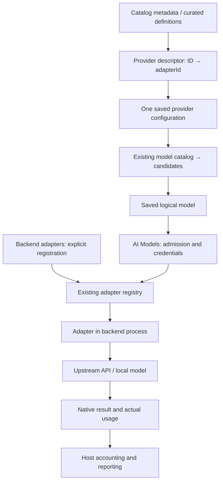
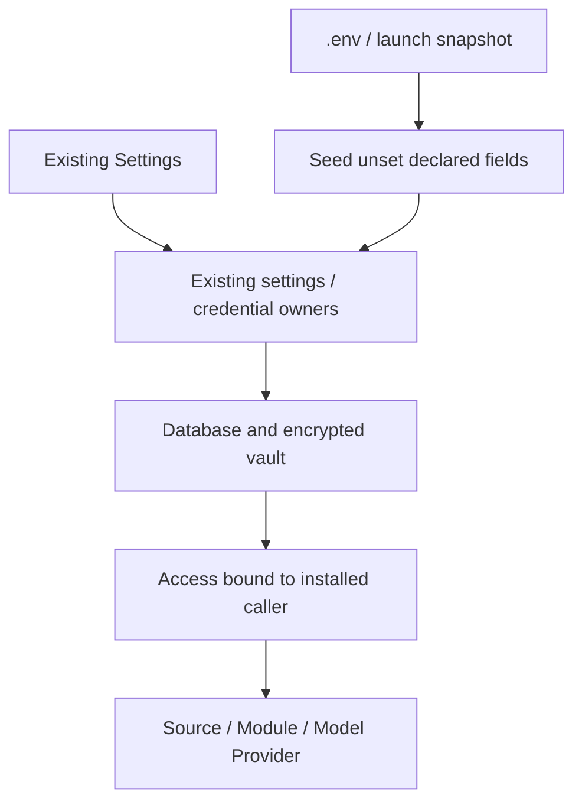

# Backend model adapters and declarative provider catalog

Status: APPROVED  
Spec lock: sha256:8e87d19808001d016359bf9ec5f22410be3b810fe2073393eb0b20c88791016c owner:approved, let's make stages and then implement  
Implementation lock: sha256:f65cd9b4f3b69438050c7dd09742f16267958556d547ee896dbce998d516f581 owner:$blueprint-start  
Active Delivery: D1  
Unattended decisions: allowed  

<!-- plan:spec:start -->
## The Goal

Separate executable model API adapters from declarative provider data. Adapter implementations are first-party backend code under backend/src/agent/adapters, compiled into the application. Provider descriptions live outside src in the existing catalog repository's providers/ directory, alongside sources/ and modules/. Multiple providers can reuse the same adapter. Existing logical model IDs, saved connection IDs and supported language, embedding, decision and native subscription behavior survive this separation.

The observable result is that all six existing adapters follow the same executable contract and are explicitly registered from the backend adapter directory. Provider names/endpoints, configuration declarations and model catalog associations are data outside backend source. Adding a compatible provider changes data; adding a new protocol changes backend adapter code and the one explicit registration list. AI consumers and the shared execution runtime do not gain vendor-specific branches.

Sources, Modules and Model Providers also share one declared configuration flow: environment values seed only unset fields in the existing persistence owners, and the same settings remain editable through the application. Saved application values and explicit clears survive restart. The new environment-managed path creates one API-key configuration per provider ID in the existing organization/person scope; previously saved connections retain their exact bindings for compatibility.

## The target

### Provider definitions share executable adapters

Adapter code lives in backend/src/agent/adapters in the core repository and runs inside the existing backend process. The existing AiProviderRegistrationService and AiProviderRegistryService explicitly enumerate/register the included implementations. Provider data lives in providers/ in the catalog repository, beside sources/ and modules/. There is no external executable provider library, new child process, transport codec, plugin runner or runtime installation of provider code. Adapter code changes require a new application build.

A provider definition is data: a stable provider ID, its endpoint/authentication/configuration description and an adapterId. An adapter is the implementation of a supported API/protocol. Several definitions can reference the same adapter. OpenRouter and another compatible endpoint can both use openai-compatible. TypeSafe and a compatible System One server can both use system-one. Native OpenAI Responses and a compatible Chat Completions API need not be falsely treated as the same protocol.

The existing AiProviderDescriptor and catalog-provider family mapping already express this distinction; reuse those owners. The normalized descriptor extends that metadata with the shared configuration declaration and model-catalog reader IDs. ModelCatalogPage remains the canonical models.dev snapshot. A provider manifest is a data file under providers/; it does not contain executable adapter code or create another installed-extension kind. Use the existing TOML parsing and canonical schema validation mechanisms.

```typescript
interface AiProviderDescriptor {
  readonly id: string;
  readonly displayName: string;
  readonly adapterId: string;
  readonly authKind: "none" | "api_key" | "native";
  readonly endpoint: string | null;
  readonly requiresEndpoint: boolean;
  readonly configuration: ExtensionConfigurationDeclaration;
  readonly catalogSourceIds: readonly string[];
}

interface AiProviderAdapter {
  readonly id: string;
  createDecisionModel?(
    binding: ResolvedAiModelBinding,
    credential: ResolvedAiCredential | null,
  ): DecisionModel;
  languageOptions?(
    options: LanguageModelV4CallOptions,
    metadata: AiReasoningMetadata,
    selection: EpisodeReasoningSelection | null,
  ): LanguageModelV4CallOptions;
  createLanguageModel(
    binding: ResolvedAiModelBinding,
    credential: ResolvedAiCredential | null,
  ): LanguageModelV4;
  createEmbeddingModel(
    binding: ResolvedAiModelBinding,
    credential: ResolvedAiCredential | null,
  ): EmbeddingModelV4;
}

interface DecisionModel {
  evaluate<const Q extends Questions>(
    request: DecisionRequest<Q>,
    recordUsage: (usage: AccountedUsage) => void,
    abortSignal?: AbortSignal,
  ): Promise<DecisionModelResult<Q>>;
}

interface DecisionModelResult<Q extends Questions = Questions> {
  readonly resolvedModelId: string;
  readonly answers: {
    readonly [K in keyof Q]: ResultFor<Q[K]> | { readonly type: "refusal" };
  };
}

interface AccountedUsage {
  readonly tokens: TokenBreakdown;
  readonly totalTokens: number;
}

interface AiCatalogSource {
  readonly id: string;
  listCandidates(providerConnectionId?: string): Promise<readonly AiCatalogCandidate[]>;
}
```

AiProviderAdapter preserves the existing executable contract; DecisionModelResult explicitly spells its existing two-field result instead of hiding it behind Pick. LanguageModelV4, EmbeddingModelV4, their options/results, EpisodeReasoningSelection, DecisionRequest, Questions, ResultFor and TokenBreakdown remain their canonical SDK contracts. ResolvedAiModelBinding, ResolvedAiCredential and AiReasoningMetadata retain their existing AI Models semantics and owning backend contracts. They do not need a new public executable SDK export solely for this move. Public provider metadata and configuration schemas remain canonical SDK contracts.

Existing backend composition wires adapters and model-catalog readers to their current registries. Nest lifecycle and the existing HTTP/artifact/configuration services remain available through their current role interfaces. Adapter code owns upstream protocol and usage translation; core services retain saved bindings, Secrets, admission, native orchestration, accounting/pricing and persistence. Existing error, HTTP policy, artifact and validation owners are reused without copying implementations into another package.

Definitions are admitted only when their adapterId exists in the explicit registry, their catalogSourceIds name registered AiCatalogSource readers and their endpoint/auth/configuration metadata is valid. These are model-catalog reader IDs, not installed data-ingestion Source IDs. Sharing a wire format does not prove every endpoint supports the same model capabilities, reasoning controls or model-listing operation. Required unknown metadata remains unknown and blocks only the operations that require it. Adding a supported data-only provider through the existing catalog refresh can reuse installed adapter code; adding or upgrading backend adapter code still requires a new application build.

For a call, AI Models resolves the saved logical model, its provider definition and exact saved connection, checks capability/access/revisions and credits, resolves credentials, and calls the registered adapter. The adapter returns the real native SDK object or DecisionModel. Language streaming retains request/response metadata, warnings, tools, reasoning, cancellation and terminal usage directly; embedding retains the entire canonical EmbeddingModelV4Result, including warnings and provider metadata. No stream/result projection or serialization may discard existing information. Decision usage is reported before validating answers so known spend survives malformed answers.

For trusted backend adapter code, use of injected provider-specific configuration instead of ambient environment is an enforced programming/build contract, not an OS sandbox. Modules retain their existing isolated runtime, and Sources retain their existing installation/transport mechanism. Only additional provider processes and hot-install machinery are excluded.

### One adapter serves multiple provider definitions

For example:

| Provider definition ID | Adapter ID | What differs |
|---|---|---|
| openrouter | openai-compatible | Endpoint, declared authentication/configuration and provider catalog metadata |
| openai-compatible | openai-compatible | Explicit operator endpoint and its verified model metadata |
| typesafe | system-one | TypeSafe endpoint and declared decision models |
| system-one-compatible | system-one | Explicit compatible endpoint and its declared models |

A definition ID identifies the service/configuration. An adapter ID identifies executable protocol behavior. A physical model ID identifies an upstream model; the saved logical model ID remains the stable consumer selection. Neither endpoint compatibility nor a catalog row establishes actual account entitlement.

The new environment workflow creates one configured key/endpoint per provider definition ID. Provider cloning, indexed IDs and personal/work environment variants are outside this outcome. Existing saved connections remain supported through their exact catalogProviderId/adapter and logical-model bindings; they are not collapsed to satisfy the new environment workflow. Upgrade and ambiguous-seed behavior is specified below.

Provider descriptions reuse the existing models.dev provider family mapping and curated definitions where the catalog lacks the necessary protocol/authentication metadata. A descriptor must not invent a supported capability, default endpoint, price or reasoning control. A new service using an implemented protocol reuses the adapter and configuration schema; it does not receive a copied adapter class. MP_* naming follows the provider definition ID, never the shared adapter ID: OpenRouter uses MP_OPENROUTER_API_KEY while its adapter remains openai-compatible.

### Provider configuration and model discovery

AI Models owns saved provider/model records. The existing Settings projection obtains descriptors from the providers/ data artifact and the existing models.dev catalog snapshot. Its ordinary configuration schema is the same one used for environment import; API keys stay with Secrets.

```typescript
interface AiProviderConnectionRecord {
  readonly id: string;
  readonly displayName: string;
  readonly adapterId: string;
  readonly baseUrl: string | null;
  readonly enabled: boolean;
  readonly credentialRequired: boolean;
  readonly configurationRevision: string;
  readonly settings: Readonly<Record<string, JsonValue>>;
}

interface AiCatalogCandidate {
  readonly sourceId: string;
  readonly providerConnectionId: string | null;
  readonly adapterId: string;
  readonly physicalModelId: string;
  readonly displayName: string;
  readonly capability: "language" | "embedding" | "decision";
  readonly dataBoundary: "device_only" | "cloud_allowed";
  readonly contextTokens: number | null;
  readonly languageCapabilities: AiLanguageCapabilities | null;
  readonly reasoning: ReasoningCapabilities;
  readonly dimensions: number | null;
  readonly normalization: "none" | "l2" | null;
  readonly artifactDigest: string | null;
  readonly price: AiPrice | null;
}
```

JsonValue, AiLanguageCapabilities, AiPrice and ReasoningCapabilities reference the existing canonical SDK/AI Models contracts. The changed candidate explicitly carries reasoning metadata and permits unavailable pricing; the SDK/management projection must use that same shape rather than a private mirror.

Discovery remains separate from inference. The provider's catalog implementation uses its validated configuration to list candidates, or uses declared models when upstream has no listing API. Selecting a candidate explicitly materializes a saved logical model. It does not run an inference probe, create a native login session or establish entitlement.

The existing AiModelCatalogService and AiCatalogSource registration remain the discovery owners. models.dev remains a shared metadata input. Provider-specific protocol/metadata translation and upstream listing/pull communication live with the backend adapters and their existing catalog readers. Provider data selects supported catalog readers and can supply explicit model entries. Artifact persistence, operation state, cancellation and storage remain with their existing owners. Local model weights are installed explicitly through that artifact path, independently of provider metadata loading.

A saved model whose adapter is absent from the current build remains saved and unavailable. A disabled provider rejects new calls; configuration changes use the existing revision checks and targeted cache invalidation. Replacing provider code happens through a new application build and normal restart, not hot adapter activation. A failed metadata refresh does not rewrite saved bindings or make unknown data executable.



### One configuration path from environment or Settings

The host reads its existing ConfigService snapshot, including the launcher's selected .env file. Existing launch precedence remains flags over process environment over .env; the resolved snapshot is only a source for first-time seeding, not a runtime override of persisted settings. An admitted Source/Module or provider data definition declares its own configuration fields; its host-verified kind and ID determine its namespace. For a provider, model-provider is a configuration namespace label, not a new installed-extension kind. The extension cannot request an arbitrary prefix or read the file. Environment names are `SOURCE_<SOURCE_ID>_<FIELD>`, `MODULE_<MODULE_ID>_<FIELD>` and `MP_<PROVIDER_ID>_<FIELD>`. Reuse envSegment: uppercase and replace hyphens with underscores. Validate the generated name and refuse collisions before importing; never guess ownership by splitting underscores.

After provider definitions, installed Source/Module declarations and the required model directory are ready, the existing SettingsService coordinates seeding before dependent work starts. It repeats that operation after newly installed Source/Module declarations or refreshed supported provider metadata are admitted. The host checks persisted state first and skips set or cleared fields before reading or validating their environment values. For an unset field, it validates the present declared environment value and imports it. An obsolete malformed environment value cannot invalidate a saved application value. Application writes and explicit clears win on every later launch. Existing imported values also remain stable when .env changes or disappears. Secrets go to the existing encrypted vault; ordinary values go to ModuleSettingsService/AppSettingsRepository, Source management or AI Models as appropriate. No extra settings database, file watcher or per-extension environment parser is added. Missing encryption fails the secret import without plaintext persistence. Each target's seed writes values, encrypted secrets, field state and affected configuration revision atomically using the existing UnitOfWork; an invalid supplied field prevents that target's import. SettingsService orchestrates, existing capability owners validate and write, and ConfigService only supplies launch inputs. A concurrent application save wins through a transactional check of the still-unset field. Failed imports leave the dependent configuration unavailable with a field-specific diagnostic, not a partially valid setup.

Modules have ordinary configuration only, described by the existing ModuleSettingsSchema and ModuleSettingField validation. Module authors must not place secrets in these settings: they are ordinary application preferences, visible through the existing Settings/portable projection. Modules have no direct network access and receive no provider/source credentials; existing host-authorized Source commands remain the path for external operations. Sources and Model Providers retain separate declared credentials because their integrations contact external services. The normalized host declaration below reuses those existing schemas and credential declarations rather than creating a second field-type system.

```typescript
type ExtensionConfigurationField =
  | {
      readonly kind: "setting";
      readonly field: ModuleSettingField;
      readonly required: boolean;
      readonly environment: boolean;
    }
  | {
      readonly kind: "secret";
      readonly key: string;
      readonly label: string;
      readonly description: string | null;
      readonly required: boolean;
      readonly environment: boolean;
      readonly delivery: "host_only" | "extension";
    };

type ExtensionConfigurationDeclaration =
  | {
      readonly kind: "module";
      readonly schema: ModuleSettingsSchema;
    }
  | {
      readonly kind: "source" | "model-provider";
      readonly fields: readonly ExtensionConfigurationField[];
    };

type ExtensionConfigurationOwner =
  | { readonly kind: "source"; readonly id: string }
  | { readonly kind: "module"; readonly id: string }
  | { readonly kind: "model-provider"; readonly id: string };

interface ExtensionConfigurationFieldStatus {
  readonly key: string;
  readonly kind: "setting" | "secret";
  readonly state: "unset" | "set" | "cleared";
  readonly origin: "env" | "application" | null;
  readonly environmentName: string | null;
}

interface ExtensionConfigurationAccess {
  readSettings(): Promise<Readonly<Record<string, JsonValue>>>;
}
```

ModuleSettingField and JsonValue are unchanged canonical SDK contracts. The existing ModuleSettingsSchema and ModuleSettingsEntry remain the module Settings presentation: the same declared fields and stored values power the current panel, and both environment seeding and application edits use ModuleSettingsService validation. There is no second configuration screen or parallel module settings schema. Model fields still require an available model of their declared capability. Existing declarations own their explicit defaults; a displayed default alone is not a persisted value and does not prevent initial environment seeding. ExtensionConfigurationAccess is bound by the host to the admitted caller and its admitted configuration target; it takes no caller-supplied owner ID. readSettings excludes secrets. A module cannot declare secret fields or obtain a secret-reading operation. Source and Model Provider credentials remain with the existing host auth/execution owners and are delivered only to the admitted integration operation using existing credential injection; host_only fields are never delivered to extension code. A secret declared for extension delivery still requires the existing permission and exact connection/user scope. The declaration kind must match its admitted owner kind; a module cannot submit a Source/Model Provider declaration to obtain credential access. Status endpoints expose state, not secret values. The origin env denotes input from the resolved launch snapshot, including the selected file and any higher-priority process/flag input; it is not a claim that the raw file supplied that value. Cleared is durable suppression, not absence; a supplied false, zero or valid empty string is also a value rather than an unset field. Field origin and clear state are metadata in the existing persistence owners; plaintext settings are not copied into a new configuration store, and secret values remain only in the encrypted vault. Removing or changing an environment variable does not delete or replace a seeded value. Explicit clear deletes its secret/value and commits suppression in the same transaction. Package reactivation and restart preserve suppression. After import, runtime resolution uses the persisted owner and never falls back to raw environment or shipped secret defaults. Application edits publish the existing settings-change/revision events after commit and invalidate only affected runtime bindings.

Installed modules from the configured trusted catalog are trusted to read their ordinary declared settings, including values initially seeded from MODULE_*; no separate publisher-signature or signing-key administration feature is required. Source installation is an explicit approval of that trusted integration under the existing installation and activation mechanism. Adapters are trusted first-party backend code included by the application build; provider files carry data rather than executable plugins. Existing exact package hashes, channel admission, Source certification and capability checks remain enforced; a hash is still an integrity check rather than a claim of cryptographic publisher identity. Access remains bound to the installed extension ID and declared fields; trust does not expose the whole environment. Existing authorized cross-module reads of non-secret portable settings through graph.moduleSettings(forSchema) remain intact. No new module credential API or direct network capability is added. Backend adapters follow the host-supplied provider configuration contract and are checked against ambient environment reads at build/test time; sharing the backend process does not provide hostile-code isolation.

Deployment prefixes never bootstrap personal OAuth refresh tokens or native subscription sessions. Those retain the existing user/account-scoped login owner. Multiple Source accounts share only fields explicitly declared deployment-scoped, such as Google OAuth application configuration. A generated `MP_<PROVIDER_ID>_<FIELD>` addresses the provider definition's environment-managed configuration, with zero/one/multiple saved-connection handling specified below. The importer retains saved IDs, creates a new configuration only when its identity is unambiguous, and never creates a Source account or native login session. Cloning or indexed IDs remain outside this plan.

Examples: SOURCE_GOOGLE_CLIENT_ID and SOURCE_GOOGLE_CLIENT_SECRET map only to Google's declared deployment fields. `MODULE_CONTEXT_<DECLARED_FIELD>` is illustrative; it neither invents a context module nor creates an undeclared setting. `MP_OPENAI_API_KEY` seeds OpenAI's one API-key configuration. The provider ID comes from the admitted provider definition, so no additional prefix must be supplied. Prefix naming is generated from admitted declarations, not reverse-parsed to infer extension ownership.



Host infrastructure configuration, such as database URLs, vault master keys and the application's own Google sign-in, stays with ConfigService and its existing owners. SOURCE_GOOGLE_CLIENT_* is Source application configuration; GOOGLE_CLIENT_* belongs to workspace authentication. Combining their values would cross distinct authorization boundaries. Fixture/build inputs are not product settings and are not imported into workspace configuration.

### Existing connection compatibility and environment seeding

No additional data contracts change in this compatibility fragment: it uses the AiProviderConnectionRecord defined above and the existing AiProviderSettingsRecord/AiProviderSaveOperation in backend/src/agent/models/types.ts.

The one-provider configuration rule describes the new environment-managed path. It does not collapse connections already supported by earlier application versions. Existing saved connections, per-connection secrets, endpoints and logical-model bindings remain executable by their exact saved IDs; no database uniqueness constraint is imposed on catalogProviderId. No new cloning, indexed IDs, personal/work variants or environment aliases are introduced, and this plan does not redesign the existing connection UI.

The importer resolves provider identity using the persisted catalogProviderId first. A legacy record without that value is associated only by existing verified migration rules: exact known built-in identity with matching adapter/endpoint semantics, or a unique existing catalog match for its explicit adapter and endpoint. Display names, row order and the shared adapter alone cannot select a provider. Ambiguous or unmatched legacy records keep their IDs, keys and runtime bindings; no association is guessed. An existing ID collision is an import error, not permission to overwrite a row.

After resolving identities, the generated `MP_<PROVIDER_ID>_<FIELD>` import handles the provider as follows:

| Saved matching configurations | Environment import |
|---|---|
| Zero, with no unresolved candidate or ID collision | Existing provider management creates the one new configuration with provider definition ID as its new ID; all supplied fields are validated and committed atomically. |
| Exactly one | Seed only its unset fields, preserving its existing connection ID, endpoint, stored key and clear state. |
| More than one, or unresolved legacy identity relevant to this provider | Refuse this provider's MP_* import with a configuration diagnostic. Do not pick the first row, copy the new key to all rows, create another row or rebind any model. Other independent targets continue. |

An ambiguous environment import does not disable fully configured saved connections: execution still follows each model's exact providerConnectionId and credential. Resolving such legacy data is an explicit edit through the existing provider-management contract, not a new environment binding/selector feature.

Legacy TYPESAFE_API_KEY and OPENAI_API_KEY compatibility uses the old exact adapter/endpoint eligibility only during the migration seed. It preserves the previous effective value for an eligible legacy unset credential, including eligible pre-existing connections, without overriding stored values or explicit clear state. That one-time compatibility mapping does not choose a target for an ambiguous new MP_* variable. The old independent runtime env fallback is removed after the migration. Authoritative existing clear-operation metadata becomes a clear marker; absence alone is not invented evidence of an earlier clear. No secret is read from legacy plaintext storage as a fallback.

The same resolution and unset checks run inside the existing configuration/secret transaction, so a concurrent application save or second creator cannot overwrite the saved choice. Clear suppression is committed with secret deletion and survives restart. Acceptance covers zero, one, multiple, unmapped legacy and conflicting-ID states without deleting or renaming an existing connection.

### Credentials and native subscriptions

AI Models remains the connection/configuration owner. Secrets remains the encrypted credential owner, including the existing `ai_provider` namespace, connection ID subject and `api_key` key. Encrypted stored credentials take precedence; a failed encrypted read is an authentication failure and does not fall through to environment lookup. Credential resolution is bracketed by the configuration revision check. Ordinary workspace exports, catalogs, logs and report pages contain no secrets.

The shared declared configuration flow above supplies provider settings and secrets. Existing TYPESAFE_API_KEY and OPENAI_API_KEY names are compatibility inputs to the same initial seed operation for their exact legacy endpoint bindings. A generated MP_* name takes priority over its legacy alias during the initial seed when both are supplied; an invalid supplied generated value fails instead of falling back. Saved values and clear markers take priority over either name. The legacy aliases do not remain an independent runtime credential lookup.

Native Codex/Claude execution stays in its existing Episode engine. Provider data and existing backend adapters own the relevant catalog/auth declarations and supported integration with that runtime; it does not convert Episodes into a generic language or decision call. Native credentials remain user-scoped with the existing login/session owner. Provider metadata exposes no shared user token cache or another user's authorization. Subscription discovery is not proof of entitlement and does not imply decision or embedding support.

Adding a new Sign in with ChatGPT flow, OAuth client identity, OAuth persistence contract or paid remotely hosted entitlement route is outside this extraction. The historical Codex subscription path is not described as the new SIWC integration. Claude continues to use subscription authentication.

### Usage and billing

Each physical upstream model operation reports actual usage through its existing native SDK result or the DecisionModel usage callback. AiRuntimeLanguageModel, AiRuntimeEmbeddingModel and the decision runtime attach the admitted provider/model/configuration identity and the caller's operation context. The existing MeteringService/BillingRepository owns the durable record and price calculation; CreditService remains the credit owner. The shared integer pricing implementation is reused. No adapter, consumer or second ledger computes or charges the same operation again.

A successful metered operation requires complete actual usage and known applicable pricing. Pricing is pinned before upstream contact through the existing effective-dated price owner. A malformed answer can fail after complete usage was received; that usage and its known cost remain reportable. A disconnect before final usage preserves a measured prefix when available and records that the evidence is partial. Without any measured usage the values are null, not fabricated zeros.

Subscription fees are never allocated to users, sessions, calls or tokens here. Subscription-covered calls have a zero per-call charge by agreement, including when usage is unavailable. Local non-metered execution likewise has no upstream per-token charge. Those explicit zero-charge policies do not require invented token prices or credit admission for a paid API. Existing native Codex/Claude authentication and orchestration remain unchanged; only available accounting evidence is reported, and there is no implicit switch to a paid API.

#### Canonical public receipt

The following is the full target of the existing SDK AiCallAccounting contract. Status describes execution; usageStatus and costStatus describe evidence. The billingMode identifies why a subscription/local charge can be known zero even when usage is unreported.

```typescript
type AiUsageStatus = "complete" | "partial" | "unreported" | "legacy";
type AiCostStatus = "complete" | "partial" | "unreported" | "legacy";
type AiBillingMode = "metered" | "subscription" | "local" | "legacy";

interface AiCallAccounting {
  readonly modelId: string;
  readonly tokens: TokenBreakdown | null;
  readonly totalTokens: number | null;
  readonly costMicros: number | null;
  readonly status: "complete" | "failed" | "aborted";
  readonly usageStatus: AiUsageStatus;
  readonly costStatus: AiCostStatus;
  readonly billingMode: AiBillingMode;
}
```

For usageStatus complete, tokens and totalTokens are validated final counters. For partial, a non-null tokens/totalTokens pair contains only a validated actually measured portion and must not be labelled the full total. If only isolated counters are known and a valid canonical breakdown cannot be constructed, keep these fields null and preserve the exact counters in providerUsageRaw; missing counter categories are not filled with invented zeros. For unreported, both are null. Legacy preserves historical numeric values without asserting that the old writer had complete evidence. TokenBreakdown is the unchanged canonical SDK non-overlapping counter contract.

CostStatus complete means a final known amount; partial means the exact amount attributable to measured consumption only, not an estimated full bill; unreported requires costMicros null. Legacy retains a historical amount with its provenance label. A metered complete execution requires complete usage and cost evidence. A partial metered report cannot yield complete execution. Subscription/local receipts have costStatus complete and costMicros 0 independently of usageStatus. A proven pre-contact rejection has known zero consumption/cost. Failure or abort alone is not proof of zero usage.

#### Durable record and caller attribution

The existing LlmCallRecord keeps its field conventions and gains explicit evidence/nullability. Its existing metadata field has the typed context below; historical metadata is retained losslessly in details. LlmCallId, TurnId, AuthUserId, PricingRowId, DateTimeUtc and LlmCallOrigin remain the existing canonical backend contracts.

```typescript
interface AiCallReportContext {
  readonly logicalModelId: string | null;
  readonly providerConnectionId: string | null;
  readonly capability: "language" | "embedding" | "decision" | null;
  readonly episodeId: string | null;
  readonly executionId: string | null;
  readonly operationId: string | null;
  readonly configurationRevision: string | null;
  readonly measurement: "call" | "native_turn" | "legacy";
  readonly details: JsonValue | null;
}

interface LlmCallRecord {
  id: LlmCallId;
  turn_id: TurnId | null;
  user_id: AuthUserId | null;
  origin: LlmCallOrigin;
  provider: string;
  model: string;
  started_at: DateTimeUtc;
  finished_at: DateTimeUtc | null;
  tokens: TokenBreakdown | null;
  cost_micros: number | null;
  price_version: PricingRowId | null;
  provider_request_id: string | null;
  providerUsageRaw: JsonValue | null;
  status: "ok" | "error";
  error: string | null;
  metadata: AiCallReportContext;
  usageStatus: AiUsageStatus;
  costStatus: AiCostStatus;
  billingMode: AiBillingMode;
}

interface RecordLlmCallReport {
  cost_micros: number | null;
  persistence: "inserted" | "duplicate" | "spooled";
}
```

The server-side Episode/process caller supplies its existing execution/operation identifiers to the host runtime; the runtime derives provider, physical model, logical model, connection, capability and revision from the admitted binding. These are not trusted values returned by the provider. provider is the provider definition ID, not the shared adapter ID. turn_id links an Episode execution to the existing agent_turn row; background operations use origin other with their owning process tag and operationId, without inventing an Episode.

System-scoped embeddings remain system-scoped: new records use user_id null, never a fabricated user or the local nil user ID. This records the expense without adding per-user embedding charges. Existing non-null user IDs, including legitimate nil IDs, remain unchanged. Authenticated user reporting retains its ownership filters; system rows are not exposed as another user's usage.

One record is finalized per physical invocation. Its id is created before contact and retained for all observations/replay of that invocation. An outer SDK multi-step operation groups its constituent calls through the existing execution/operation context; its returned aggregate receipt is not an extra chargeable ledger row. SDK embedding batches follow the same rule. Native engines that expose only a whole-turn report write one native_turn measurement and do not also fabricate constituent calls; their turn summary is not added again to call totals.

Existing insertion deduplication and credit mutation must share an idempotent finalization in the existing database/UnitOfWork path. The same record ID cannot debit twice, even when provider_request_id is absent. Upstream request-ID deduplication is scoped to the actual connection so legacy accounts cannot collide. The same measured prefix cannot be charged once as partial and again by replay; a repeated finalization reads its recorded outcome. Known partial cost can be charged only for that actual measured usage and known price, with costStatus partial; the unknown remainder is never charged as if known. Existing hosted reservation/expiry policy remains separate from reporting actual consumption and is not rewritten by this extraction.

The existing spool uses the same record schema and replay identity; it does not turn unavailable counters into zero. The actual record/replay transaction is an implementation detail of the existing owners, not permission to create another queue, journal or credit store.

#### Aggregate reports retain evidence

Existing SDK report fields remain recognizable but accept null when no value was reported. Aggregates sum known complete/partial/legacy values without inventing contributions for unreported calls. Coverage makes a known sum distinguishable from a full total. A nonempty group with no known values returns null for that metric; a known subscription/local zero remains 0. Empty-result behavior remains the existing empty list/null group behavior.

```typescript
interface BillingCoverage {
  readonly completeCalls: number;
  readonly partialCalls: number;
  readonly unreportedCalls: number;
  readonly legacyCalls: number;
}

interface BillingDailyRow {
  readonly day: string;
  readonly provider: string;
  readonly model: string;
  readonly tokens: TokenBreakdown | null;
  readonly costMicros: number | null;
  readonly callCount: number;
  readonly usageCoverage: BillingCoverage;
  readonly costCoverage: BillingCoverage;
}

interface BillingEpisodeRow {
  readonly episodeId: string;
  readonly startedAt: string;
  readonly endedAt: string;
  readonly totalTokens: number | null;
  readonly costMicros: number | null;
  readonly callCount: number;
  readonly usageCoverage: BillingCoverage;
  readonly costCoverage: BillingCoverage;
}

interface EpisodeCost {
  readonly episodeId: string;
  readonly tokens: TokenBreakdown | null;
  readonly costMicros: number | null;
  readonly usageCoverage: BillingCoverage;
  readonly costCoverage: BillingCoverage;
}

interface EpisodeUsage {
  readonly episodeId: string;
  readonly inputTokens: number | null;
  readonly outputTokens: number | null;
  readonly cacheReadTokens: number | null;
  readonly cacheWriteTokens: number | null;
  readonly cacheWriteOneHourTokens: number | null;
  readonly reasoningTokens: number | null;
  readonly costMicros: number | null;
  readonly callCount: number;
  readonly firstCallAt: string | null;
  readonly lastCallAt: string | null;
  readonly usageCoverage: BillingCoverage;
  readonly costCoverage: BillingCoverage;
}

interface EpisodeUsageSummary {
  readonly episodeId: Id;
  readonly episodeTitle: string | null;
  readonly totalTokens: number | null;
  readonly costMicros: number | null;
  readonly usageCoverage: BillingCoverage;
  readonly costCoverage: BillingCoverage;
}

type AgentTurnAccounting =
  | {
      readonly kind: "reported";
      readonly totalTokens: number;
      readonly costMicros: number;
    }
  | {
      readonly kind: "partial";
      readonly totalTokens: number | null;
      readonly costMicros: number | null;
    }
  | { readonly kind: "unreported" };
```

Each coverage object counts the records with that evidence status, and its four counts sum to callCount where callCount is present. EpisodeCost uses the same underlying Episode group. Current internal DailyAggregateRow/RecentEpisodeRow and LlmCallRow retain their existing storage/wire naming conventions while carrying these same nullable metrics and evidence; they do not introduce a different completeness rule.

A turn projection uses reported only when its final totals are complete. Partial carries whichever final total is known, including costMicros 0 for a subscription with unavailable token usage; any unknown final total is null. The known measured prefix remains in the detailed ledger. Existing agent_turn nullable columns already support these projections. No Episode/turn summary is charged or summed again on top of its underlying measurements.

The existing reports/UI display an unreported amount as unknown, a partial known sum as incomplete, and a subscription/local known zero as zero. They must not apply COALESCE-to-zero or frontend numeric defaults to missing evidence. Coverage is data for the existing presentation, not a new reporting page or control.

#### Compatibility and migration

The declarations above define the coordinated SDK/backend/client reporting version. The release includes matching generated SDK schemas, backend, CLI, frontend consumers and catalog stubs. A numeric-only client uses the matching updated SDK to consume this nullable reporting contract; unavailable evidence is never encoded as zero for an old decoder.

Existing ledger rows keep their IDs, numeric counters, monetary amounts and original metadata. Backfill evidence and billing mode as legacy without inferring completeness from old zero values; do not relabel old placeholders as measured zero. Preserve original metadata in details and set newly unavailable context fields to null. Existing old spool entries are decoded by one explicit compatibility adapter in the existing spool owner and mapped the same way; new entries use the new record shape.

Existing non-null records continue contributing the same numeric amounts to spend reports, marked legacy. Aggregate SQL, row decoders and schemas propagate nullable counters and coverage rather than letting SUM/COALESCE hide missing usage. New rows store unavailable token counters/cost as SQL null with explicit status, using the existing llm_call table rather than another ledger.

The preserved behavior of current successful paid calls and user credit balances remains: pricing still uses the canonical integer-micros computation and the existing credit owner. New incomplete reports add honest evidence rather than guessed usage. Schema migration and all affected readers are verified together before publication.


### Provider files and repository ownership

The catalog repository has a top-level providers/ directory alongside sources/ and modules/. A provider file such as providers/openrouter.toml declares one AiProviderDescriptor and its optional explicitly listed models. Shared protocol implementations remain backend/src/agent/adapters/openai-compatible-provider.adapter.ts and the other backend adapters. The adapter registry is an explicit backend code list, not executable configuration loaded from the catalog.

The catalog build normalizes provider files into a metadata-only document using the same canonical descriptor/candidate schemas. This document contains no credentials or executable code:

```typescript
interface AiProviderCatalogEntry {
  readonly provider: AiProviderDescriptor;
  readonly models: readonly AiCatalogCandidate[];
}

interface AiProviderCatalogDocument {
  readonly schemaVersion: 1;
  readonly entries: readonly AiProviderCatalogEntry[];
}
```

A manifest's models list contains discovery data only: providerConnectionId is null and no saved logical model or credential is created by parsing it. The containing entry identifies the provider. Existing discovery binds candidates to that provider's actual saved configuration before materialization. A declared model's adapterId must match its provider, its capability must be implemented, and its sourceId must identify an admitted model-catalog reader. An empty explicit models list is valid when catalogSourceIds supplies discovery from models.dev or a provider API; missing required manifest fields are rejected rather than defaulted.

Several catalog readers can contribute to one provider. For OpenAI, language candidates can come from models.dev while a verified configured-provider reader or explicit entries supply decision/embedding candidates. Each candidate carries its own capability. Core selects the corresponding method on the one openai adapter and uses the same configured API key. A decision capability does not imply the System One wire protocol: OpenAI Decisions and TypeSafe System One remain separate implementations of the same canonical DecisionModel interface.

The existing catalog build/channel and application data packaging supply the validated provider document through their normal artifact path, beside the existing metadata snapshots. Extend those owners instead of adding a package manager or a catalog registry. The backend reads admitted metadata through its existing runtime-root/catalog owner; it does not scan a sibling checkout or execute code from provider files. Existing models.dev refresh remains a source of supported metadata.

This outcome requires one catalog PR for providers/ data and its build output, and one closed-host PR for backend adapter organization, canonical metadata admission and integrated configuration/reporting. They share this plan and target their own staging branches. The SDK owns metadata contracts; executable adapter types remain backend-internal unless another actual caller requires an export. Both repositories use matching metadata versions before assembled verification. Protected merges remain the owner's action.

### Evidence and reuse

Canonical existing backend names are resolved from their owning repository before authoring the cross-repository Deliveries:

| Term | Meaning | Not | Definitions |
|---|---|---|---|
| LlmCallRecord | Existing model-call reporting record; preserve established field names | | model-provider-host:backend/src/core/llm-call.ts#LlmCallRecord |
| RecordLlmCallReport | Existing metering insertion result; preserve cost_micros | | model-provider-host:backend/src/core/llm-call.ts#RecordLlmCallReport |

Inspected existing owners:
- Host `docs/architecture/reuse-map.md`: ConfigService, module preferences, Secrets, AI Models, extension installation and existing harnesses.
- `backend/src/agent/models/types.ts`, adapter registry/registration and `ai-models.module.ts`: the existing executable adapter contract and explicit assembly point.
- `ai-provider-settings.service.ts`, `model-catalog.ts` and `models-dev-catalog.source.ts`: many provider descriptors already reference shared adapter families.
- `ai-runtime-language-model.ts`, `ai-runtime-embedding-model.ts` and `ai-sdk-runtime.service.ts`: native SDK behavior, admission and runtime accounting.
- `packages/sdk/src/core/ai-model.ts`, `decision-model.ts`, `module-settings.ts` and `backend/src/core/llm-call.ts`: canonical data/reporting contracts.
- `ConfigService`, `config/env-file.ts`, `app/commands/serve-config.ts`, `SettingsService`, `ModuleSettingsService`, `AppSettingsRepository` and Secrets/UnitOfWork: the existing configuration and persistence path.
- Source auth, credential management, binding pool and `source-protocol.adapter.ts`: current environment naming, account/deployment scope and repeated resolution rules.
- `frontend/src/modules/settings/ModuleSettingsPanel.tsx`, provider forms and their hooks: existing schema-driven Settings and provider-specific admission branches.
- Catalog `scripts/build-plugins.ts`, `scripts/build-catalog-index.ts`, existing SDK packages and host-stubs: reuse existing metadata build and canonical-contract distribution paths without loading host-stubs at runtime.

The registered implementations are anthropic, openai, openai-compatible, ollama, local-fastembed and system-one. All six are included under the backend adapter directory, organized by actual protocol/runtime behavior rather than one copied implementation per provider name. Native Codex/Claude engines retain their existing separate Episode integration.

The catalog checkout is the existing model-providers task checkout; host evidence was read-only from magnis-app staging. Unmerged Jev/dedup work is not an implicit dependency and its smoke environment is outside this plan.

### Configuration audit findings and required consolidation

This read-only audit traced configuration through host core/services, SDK contracts, frontend Settings, launch/CLI code and public catalog modules/Sources. It covered environment/file reads, settings writes, credential precedence, runtime delivery and package admission. It is not a claim that every unrelated algorithm in these repositories has undergone a complete DRY/SOLID review. No implementation or runtime tests were run for this audit.

1. **Repeated Source precedence already differs.** `source-auth.operation.ts:531` reads vault then environment even without configured encryption; `source-host.server.ts:1072` and `source-binding.pool.ts:142` return early without encryption. `source.service.ts:981` independently derives configured status. Admission, status, authentication and execution therefore do not share one resolution rule. All four must consume the canonical persisted result after shared seeding, preserving account-generation credential lookup as its own scoped operation.
2. **Clear is not durable suppression.** `ai-model-management.service.ts:172` deletes the vault key, while `ai-provider-credential-resolver.service.ts:61` then reads environment again. `source-credential.resolver.ts:264` deletes the Source deployment value, while Source auth still has its own env read. With the corresponding environment value present, a later read can restore effective access. The target persists clear state atomically and removes runtime env fallbacks.
3. **Provider configuration still requires vendor branches in core and UI.** `ai-provider-credential-resolver.service.ts:86` recognizes TypeSafe/OpenAI by adapter and endpoint. `ai-provider-settings.service.ts:95` and `frontend/.../useProviderConnectionForm.ts:84` independently encode provider-specific admission/verification behavior, including system-one exceptions. Provider descriptors must supply these rules through the existing Settings path; adding a data-only provider must not require editing the form, fixed adapter enum or common resolver. A new protocol implementation is deliberately added to the one explicit build registration list.
4. **Module Settings is reusable; logging redaction does not make it a credential store.** `module-settings.service.ts:38` already owns field validation, model-directory checks, persistence and events, and the existing frontend renders the canonical schema. Its portable/read path at lines 67–80 filters names using the logging redaction predicate. The target keeps modules as ordinary settings only: no module secrets, secret declarations or vault-reading API. Source/Model Provider declared credentials continue through their own existing encrypted credential owners. No parallel provider field-type system or new generic settings database is needed.
5. **Generated prefixes can collide.** `source-protocol.adapter.ts:488` uppercases and substitutes hyphens, then concatenates ID and key. For example, Source `acme` with field `api_key` and Source `acme-api` with field `key` both generate SOURCE_ACME_API_KEY. The target validates the complete generated-name ownership map during admission and refuses an ambiguous import; it never infers ownership by splitting the variable name.

Existing mechanisms to keep: the host's one env parser and resolved ConfigService snapshot; ModuleSettingsService validation; the existing database/vault and UnitOfWork; Source credential locators tied to user/account generation; provider revision checks; canonical SDK types; schema-driven Settings; and child environment projection. Shared environment import must not bypass any of them. Existing authorized cross-module non-secret settings reads remain intact; Source/Model Provider credential delivery remains connection/account scoped and modules receive no secret access.

Separate findings outside this outcome: the public catalog's retired development-only local Source still reads NOTES_DIR/STORAGE_DIR directly (`sources/local/src/surfaces/notes/scan.ts:20`); its manifest explicitly retires active sync. Fixture switches and build/launcher process variables likewise are not application settings. They are recorded here without authorizing a fixture migration or launcher rewrite. Workspace Google login and Google Source deliberately have different credentials and must not be merged because their names look similar.

### Migration and verification outline

This remains planning only. The implementation contract is authored after SPEC approval.

1. Extend canonical SDK metadata/configuration contracts and the existing catalog build for providers/ data. Reproduce duplicate/missing adapter admission, invalid catalog-reader references and invalid provider/model/configuration metadata before implementing the migration.
2. Organize TypeSafe/system-one under backend/src/agent/adapters through the same native AiProviderAdapter contract. Prove a deterministic decision result/refusal, actual usage reporting, known-usage preservation on malformed answers and host accounting. Remove replaced native registration.
3. Organize the remaining five adapters and their protocol/reasoning mapping under the same backend directory. Move curated provider descriptions and explicit model data into providers/. Prove two data definitions use one compatible adapter without copied implementation code. Keep existing backend HTTP/error/artifact/validation ownership and explicit registrations.
4. Integrate shared seed-only configuration through existing settings/credential owners, including zero/one/multiple/legacy identity resolution with refusal of ambiguous imports. Consolidate Source admission/auth/status/execution resolution. Replace provider-name UI/core configuration branches with descriptor data and keep one executable registration list. Implement the declared receipt/ledger/report migration through the existing metering, credit, spool and Episode projection owners; update SDK schemas/consumers and nullable-aware aggregates together.
5. Preserve saved IDs, preferences, private classifications, local artifacts, native subscription operation and existing native SDK metadata. Verify missing adapter, disabled configuration, restart and missing required values. Include the provider metadata document and existing local/native dependencies in launch/desktop packaging.
6. Run scoped agent checks during implementation, then the complete diff-selected gates and required implementation review for each complete repository Delivery. Publish through planctl and observe CI. The owner merges protected branches.

Exact scoped RED commands, Stage commits, metadata artifact production/consumption commands and target host checkout are implementation-contract work. This SPEC does not authorize model runs, benchmarks, a new dev server or implementation workers.

### Acceptance cases

- All six existing adapters execute from backend/src/agent/adapters in the current backend process; providers/ holds declarative provider/model data outside src. No new provider process, generic wire protocol, runtime installation or duplicate registry is introduced.
- Two provider definitions with the same implemented protocol use the same adapter instance/implementation with separate admitted configuration identities. Adding a supported metadata-only provider requires no consumer/runtime/form vendor branch or copied adapter code. A new protocol implementation changes backend adapter code and one explicit build registration.
- Duplicate IDs, absent adapters, invalid endpoints/authentication/configuration and unsupported capabilities fail explicitly. Shared API family alone cannot invent model capabilities or entitlement.
- Existing logical model IDs, provider connection IDs, per-connection keys/endpoints, preferences and valid reasoning selections survive upgrade and restart. Two legacy connections to one descriptor retain their original model bindings and execution. A new MP_* import in that ambiguous state is refused without overwriting, rebinding or disabling either fully configured connection. Unmapped legacy identities and ID collisions do not create guessed associations or extra rows. Missing adapter code leaves dependent models saved and unavailable.
- Language native streams preserve tools, reasoning, ordering, cancellation, native request/response metadata, warnings and terminal usage. Embedding returns the full canonical result, including native usage, nonempty warnings, provider metadata and response data. No serialization projection strips fields.
- Decision answers/refusals and actual usage retain their canonical contract. Invalid answers, failed calls and aborts preserve already-known usage. Missing metered usage cannot become a successfully accounted call.
- Embedding input order, batching, finite vectors, dimensions, normalization and artifact checks are preserved. Missing local artifacts fail. Native assets and package dependencies are present in the assembled release.
- SOURCE_*, MODULE_* and MP_* names derive from admitted IDs and declared fields, with collision rejection. Only unset values are seeded. Saved values, false/zero/valid empty values and explicit clears survive restart; changed or removed environment values cannot overwrite or resurrect them.
- Module Settings and environment import use the same canonical field validation, including model capability checks. Modules contain no secret declarations or credential API and gain no direct network access. Existing authorized portable cross-module settings reads remain valid.
- Source configured status, admission, auth and execution read the same persisted configuration. Source/Provider credentials remain encrypted and scoped; missing encryption prevents secret import, and a failed read never falls through to environment.
- Application saves win races with environment seeding. Invalid fields cause no partial target import. Existing change events/revisions and targeted binding invalidation follow committed changes.
- Subscription fees are not allocated to calls; subscription-covered calls have costStatus complete and costMicros 0 even when usageStatus is unreported and token counters are null. Successful metered calls require complete usage and cost evidence. A disconnect records measured partial evidence or unreported null values without a fabricated full amount or automatic paid fallback.
- Deterministic reporting cases cover complete paid usage, a measured prefix then failure, no usage after contact, known pre-contact zero, a subscription without usage, a local model without counters, and historical/spooled legacy rows. Receipt, ledger, turn projections and aggregate coverage agree; SQL/frontend defaults cannot turn null into zero. Replaying one call ID cannot duplicate a ledger expense or credit debit. Outer/turn summaries do not double-count underlying physical calls.
- MP_* names use provider definition IDs independently of adapter IDs; OpenRouter and another compatible provider can share openai-compatible while retaining their own declared configuration. The metadata document is delivered through existing catalog/application data packaging, contains no executable code or secrets and cannot select an unregistered adapter/catalog reader. Existing launch packaging includes the required data and runtime/native dependencies.

### Constraints

No implementation until explicit SPEC and implementation-contract approvals. The agreed target is first-party backend adapter code with explicit in-process registration and provider/model metadata outside src in providers/. No separate executable provider library is required. Runtime hot installation, additional provider processes, serialization codecs, provider cloning/indexed IDs, separate publisher-signature infrastructure and new OAuth products are outside this outcome.

Use existing Settings layouts/components. No new frontend layout or controls are approved; obtain mockup approval if the final contract cannot fit the existing presentation. Preserve the existing EnterpriseRAG/Jev plan and smoke processes, ports, database and settings. Keep Git hooks enabled and preserve other agents' work.

### Remaining contract work

The SPEC defines the public, durable and aggregate reporting contracts, the coordinated migration, and existing-connection compatibility above. The implementation contract still needs the exact host checkout, metadata artifact workflow, scoped RED tests, Deliveries and Stages; these are implementation planning details after SPEC approval.

This draft replaces the earlier child-process and external executable-library proposals. Its current behavior and contracts require final SPEC approval before the implementation contract is approved.
<!-- plan:spec:end -->

<!-- plan:implementation:start -->
## Implementation contract

<!-- plan:delivery:D1:start -->
<!-- plan:delivery-meta:{"active":true,"depends":[],"predictedExternalWaitMinutes":25,"review":"required","repository":"model-provider-host"} -->
### PR Delivery D1 — Backend model adapters, declared configuration and usage reporting

Branch: `feat/model-providers-core`; Depends: none; Gate: bun run agent:verify:pr.

Stage graph: `D1-S1 -> D1-S2 -> D1-S3 -> D1-S4 -> D1-S5 -> D1-S6 -> D1-S7 -> D1-S8`.

Forecast: 545 active min / 57 credits across 8 Stages; longest dependency path 545 active min; external waits 25 min.

The backend resolves declarative provider data through its six existing compiled adapters, seeds declared configuration through existing Settings/Secrets owners, and reports actual usage with explicit completeness and replay-safe billing. SDK contracts originate in this repository; generated catalog declarations use those contracts rather than a second schema. This is one host PR into staging in the isolated model-providers-core checkout. The catalog is a separate PR because it is a separate repository. Cross-repository Stage dependencies permit SDK definitions before catalog metadata, and matching catalog artifacts before final runtime packaging; neither requires merging an unfinished PR. This contract covers both complete PRs, their required implementation reviews, fixes, local gates, publication and CI. No implementation workers, live model runs, benchmarks, new product controls or dev servers are authorized. Protected merges remain the owner's action.

<!-- plan:stage:D1-S1:start -->
<!-- plan:stage-meta:{"deliveryId":"D1","depends":[],"parallelWith":[],"writes":["packages/sdk/src/core/ai-model.ts","packages/sdk/src/core/extension-configuration.ts","packages/sdk/src/core/module-settings.ts","packages/sdk/src/core/source.ts","packages/sdk/src/core/plugin.ts","packages/sdk/src/index.ts","packages/sdk/package.json","packages/sdk/test/","backend/src/agent/models/","backend/src/core/ai-model.ts","backend/src/core/plugin.ts","backend/src/services/modules/","backend/src/services/sources/","backend/test/tst_bts_ai_models_contract.test.ts","backend/test/tst_bts_module_settings_pure.test.ts","scripts/gen-host-stubs.sh"],"tempRoot":".tmp/code-production/2026-11-13-model-providers/D1-S1","predictedActiveMinutes":65,"predictedCredits":7,"verifyActiveMinutes":10,"verifyCredits":1} -->
#### Stage D1-S1 — Canonical provider metadata and configuration declarations

- Owner: Codex (single implementation owner); Profile: strong; Depends: none; Parallel with: none.
- Writes: `packages/sdk/src/core/ai-model.ts`, `packages/sdk/src/core/extension-configuration.ts`, `packages/sdk/src/core/module-settings.ts`, `packages/sdk/src/core/source.ts`, `packages/sdk/src/core/plugin.ts`, `packages/sdk/src/index.ts`, `packages/sdk/package.json`, `packages/sdk/test/`, `backend/src/agent/models/`, `backend/src/core/ai-model.ts`, `backend/src/core/plugin.ts`, `backend/src/services/modules/`, `backend/src/services/sources/`, `backend/test/tst_bts_ai_models_contract.test.ts`, `backend/test/tst_bts_module_settings_pure.test.ts`, `scripts/gen-host-stubs.sh`.
- Temp root: `.tmp/code-production/2026-11-13-model-providers/D1-S1` (must be absent at handoff).
- Of which verification: 10 active min / 1 credits.

Provider metadata declares its executable adapter, catalog readers and scoped fields through one canonical SDK schema. Execute in the owning repository; preserve existing configuration and runtime ownership. Record necessary caller changes and verification in Stage results.

##### Tasks

- [ ] D1S1_T1 — Provider metadata declares its executable adapter, catalog readers and scoped fields through one canonical SDK schema. (55 min)
<!-- plan:task-meta:{"writes":["packages/sdk/src/core/ai-model.ts","packages/sdk/src/core/extension-configuration.ts","packages/sdk/src/core/module-settings.ts","packages/sdk/src/core/source.ts","packages/sdk/src/core/plugin.ts","packages/sdk/src/index.ts","packages/sdk/package.json","packages/sdk/test/","backend/src/agent/models/","backend/src/core/ai-model.ts","backend/src/core/plugin.ts","backend/src/services/modules/","backend/src/services/sources/","backend/test/tst_bts_ai_models_contract.test.ts","backend/test/tst_bts_module_settings_pure.test.ts","scripts/gen-host-stubs.sh"],"predictedActiveMinutes":55,"predictedCredits":6,"how":"Add RED schema cases for a shared adapter with distinct provider identities, invalid metadata/capability declarations and ordinary Module fields rejecting secrets. Extend AiProviderDescriptor and AiCatalogCandidate and introduce the approved ExtensionConfigurationDeclaration through existing SDK schemas. Retain executable AiProviderAdapter and native SDK models in their existing backend owner. Reuse ModuleSettingField and existing Source credential declarations; preserve plugin wire envelopes and existing manifests while admitting explicit environment metadata. Update necessary descriptor/model callers and test fixtures together so this commit typechecks. Expose schema exports through the SDK's existing distribution and gen-host-stubs path. Metadata generation must consume executable SDK validators at build time; backend runtime never imports host-stubs.","red":"bun run agent:test:backend -- test/tst_bts_ai_models_contract.test.ts"} -->

##### Acceptance criteria

- [ ] `bun run agent:test:backend -- test/tst_bts_ai_models_contract.test.ts test/tst_bts_module_settings_pure.test.ts` exits 0 — canonical schemas validate provider IDs, reader references and ordinary Module fields
- [ ] `bun run agent:build:sdk` exits 0 — the canonical SDK builds with matching declarations
- [ ] Commit

##### Results

<!-- plan:results:D1-S1:start -->
| Task | Commit | UTC start-end | Active / elapsed | Usage | Result / proof |
|---|---|---|---:|---|---|
<!-- plan:results:D1-S1:end -->
<!-- plan:stage:D1-S1:end -->

<!-- plan:stage:D1-S2:start -->
<!-- plan:stage-meta:{"deliveryId":"D1","depends":["D1-S1","D2-S1"],"parallelWith":[],"writes":["backend/src/agent/adapters/","backend/src/agent/models/","backend/src/agent/decisions/","backend/src/agent/reasoning/","backend/data/","backend/test/tst_bts_ai_models_contract.test.ts","backend/test/tst_bts_ai_models_module.test.ts","backend/test/tst_bts_ai_local_catalog.test.ts","backend/test/tst_bts_ai_runtime_language.test.ts","backend/test/tst_bts_ai_runtime_embedding.test.ts","backend/test/tst_bts_ai_runtime_decision.test.ts"],"tempRoot":".tmp/code-production/2026-11-13-model-providers/D1-S2","predictedActiveMinutes":60,"predictedCredits":6,"verifyActiveMinutes":10,"verifyCredits":1} -->
#### Stage D1-S2 — Compiled adapters consume admitted provider metadata

- Owner: Codex (single implementation owner); Profile: strong; Depends: D1-S1, D2-S1; Parallel with: none.
- Writes: `backend/src/agent/adapters/`, `backend/src/agent/models/`, `backend/src/agent/decisions/`, `backend/src/agent/reasoning/`, `backend/data/`, `backend/test/tst_bts_ai_models_contract.test.ts`, `backend/test/tst_bts_ai_models_module.test.ts`, `backend/test/tst_bts_ai_local_catalog.test.ts`, `backend/test/tst_bts_ai_runtime_language.test.ts`, `backend/test/tst_bts_ai_runtime_embedding.test.ts`, `backend/test/tst_bts_ai_runtime_decision.test.ts`.
- Temp root: `.tmp/code-production/2026-11-13-model-providers/D1-S2` (must be absent at handoff).
- Of which verification: 10 active min / 1 credits.

All six adapters execute in the backend process and resolve provider data through the existing registries. Execute in the owning repository; preserve existing configuration and runtime ownership. Record necessary caller changes and verification in Stage results.

##### Tasks

- [ ] D1S2_T1 — All six adapters execute in the backend process and resolve provider data through the existing registries. (50 min)
<!-- plan:task-meta:{"writes":["backend/src/agent/adapters/","backend/src/agent/models/","backend/src/agent/decisions/","backend/src/agent/reasoning/","backend/data/","backend/test/tst_bts_ai_models_contract.test.ts","backend/test/tst_bts_ai_models_module.test.ts","backend/test/tst_bts_ai_local_catalog.test.ts","backend/test/tst_bts_ai_runtime_language.test.ts","backend/test/tst_bts_ai_runtime_embedding.test.ts","backend/test/tst_bts_ai_runtime_decision.test.ts"],"predictedActiveMinutes":50,"predictedCredits":5,"how":"Add RED admission cases for a missing adapter/reader and incompatible capabilities, plus native-result preservation in language, embedding and decision tests. Move implementations and protocol-specific reasoning/catalog translation to backend/src/agent/adapters using the compiler to resolve imports. Keep one AiProviderRegistrationService list and existing catalog reader registration; no extra registry or process. Load the D2-S1 generated metadata through the current model catalog/runtime-root owners, selecting an exact provider definition and saved connection. Replace curated source constants with the artifact; missing required data fails rather than using a second metadata copy. Preserve saved logical IDs, reasoning choices, local artifacts, cancellation, language stream metadata and full embedding results. Exercise local/native behavior with deterministic existing test doubles and no live provider calls.","red":"bun run agent:test:backend -- test/tst_bts_ai_models_module.test.ts"} -->

##### Acceptance criteria

- [ ] `bun run agent:test:backend -- test/tst_bts_ai_models_module.test.ts test/tst_bts_ai_local_catalog.test.ts` exits 0 — metadata admission preserves registry and local artifact behavior
- [ ] `bun run agent:test:backend -- test/tst_bts_ai_runtime_language.test.ts test/tst_bts_ai_runtime_embedding.test.ts test/tst_bts_ai_runtime_decision.test.ts` exits 0 — native contracts and deterministic decision/refusal behavior survive the move
- [ ] Commit

##### Results

<!-- plan:results:D1-S2:start -->
| Task | Commit | UTC start-end | Active / elapsed | Usage | Result / proof |
|---|---|---|---:|---|---|
<!-- plan:results:D1-S2:end -->
<!-- plan:stage:D1-S2:end -->

<!-- plan:stage:D1-S3:start -->
<!-- plan:stage-meta:{"deliveryId":"D1","depends":["D1-S2","D2-S2"],"parallelWith":[],"writes":["backend/src/services/settings/","backend/src/config/","backend/src/services/module-settings/","backend/src/services/app-settings/","backend/src/services/secrets/","backend/src/services/sources/","backend/src/agent/models/","backend/src/db/schema/","backend/migrations/","backend/src/db/migrations.ts","backend/test/tst_bts_declared_configuration.test.ts","backend/test/tst_bts_settings_facade.test.ts","backend/test/tst_bts_app_serve_config.test.ts"],"tempRoot":".tmp/code-production/2026-11-13-model-providers/D1-S3","predictedActiveMinutes":70,"predictedCredits":7,"verifyActiveMinutes":10,"verifyCredits":1} -->
#### Stage D1-S3 — Seed-only settings import with durable clears

- Owner: Codex (single implementation owner); Profile: strong; Depends: D1-S2, D2-S2; Parallel with: none.
- Writes: `backend/src/services/settings/`, `backend/src/config/`, `backend/src/services/module-settings/`, `backend/src/services/app-settings/`, `backend/src/services/secrets/`, `backend/src/services/sources/`, `backend/src/agent/models/`, `backend/src/db/schema/`, `backend/migrations/`, `backend/src/db/migrations.ts`, `backend/test/tst_bts_declared_configuration.test.ts`, `backend/test/tst_bts_settings_facade.test.ts`, `backend/test/tst_bts_app_serve_config.test.ts`.
- Temp root: `.tmp/code-production/2026-11-13-model-providers/D1-S3` (must be absent at handoff).
- Of which verification: 10 active min / 1 credits.

Application values and explicit clears survive restart while environment values fill only unset declared fields. Execute in the owning repository; preserve existing configuration and runtime ownership. Record necessary caller changes and verification in Stage results.

##### Tasks

- [ ] D1S3_T1 — Application values and explicit clears survive restart while environment values fill only unset declared fields. (60 min)
<!-- plan:task-meta:{"writes":["backend/src/services/settings/","backend/src/config/","backend/src/services/module-settings/","backend/src/services/app-settings/","backend/src/services/secrets/","backend/src/services/sources/","backend/src/agent/models/","backend/src/db/schema/","backend/migrations/","backend/src/db/migrations.ts","backend/test/tst_bts_declared_configuration.test.ts","backend/test/tst_bts_settings_facade.test.ts","backend/test/tst_bts_app_serve_config.test.ts"],"predictedActiveMinutes":60,"predictedCredits":6,"how":"Write RED coordinator cases for unset/set/cleared fields, false/zero/valid-empty settings, collision rejection and application-save races using existing DB/settings harnesses. Extend SettingsService to orchestrate seeding from the existing resolved ConfigService snapshot after admitted declarations and the saved model directory are ready. Existing capability owners validate and persist; there is no new parser, settings DB or startup supervisor. Persist field state and clear tombstones with ordinary values or encrypted secrets and the owning revision in one UnitOfWork transaction. Validate a target before writing any of it; unavailable encryption or missing required values remains an explicit error. Skip persisted set/cleared fields before validating obsolete env values; reject complete-name collisions using the existing envSegment transformation. Preserve launch precedence and repeat seeding only on startup or relevant existing admission/refresh events.","red":"bun run agent:test:backend -- test/tst_bts_declared_configuration.test.ts"} -->

##### Acceptance criteria

- [ ] `bun run agent:test:backend -- test/tst_bts_declared_configuration.test.ts test/tst_bts_settings_facade.test.ts` exits 0 — seed-only import, atomicity, clears and save races obey the declared ownership
- [ ] `bun run agent:test:backend -- test/tst_bts_app_serve_config.test.ts` exits 0 — flags/process environment/.env launch precedence is preserved
- [ ] Commit

##### Results

<!-- plan:results:D1-S3:start -->
| Task | Commit | UTC start-end | Active / elapsed | Usage | Result / proof |
|---|---|---|---:|---|---|
<!-- plan:results:D1-S3:end -->
<!-- plan:stage:D1-S3:end -->

<!-- plan:stage:D1-S4:start -->
<!-- plan:stage-meta:{"deliveryId":"D1","depends":["D1-S3"],"parallelWith":[],"writes":["backend/src/services/sources/","backend/src/services/settings/","backend/src/agent/models/","backend/src/services/module-settings/","frontend/src/modules/settings/","packages/sdk/src/core/ai-model.ts","backend/test/tst_bts_ai_models_control_plane.test.ts","backend/test/tst_bts_settings_app_ai.test.ts","backend/test/tst_bts_source_auth_http.test.ts","backend/test/tst_bts_source_host_command.test.ts","backend/test/tst_bts_declared_configuration.test.ts","frontend/src/modules/settings/__tests__/ModelsPanel.decision.test.tsx","frontend/src/modules/settings/hooks/"],"tempRoot":".tmp/code-production/2026-11-13-model-providers/D1-S4","predictedActiveMinutes":75,"predictedCredits":8,"verifyActiveMinutes":10,"verifyCredits":1} -->
#### Stage D1-S4 — Provider compatibility and one Source configuration resolution

- Owner: Codex (single implementation owner); Profile: strong; Depends: D1-S3; Parallel with: none.
- Writes: `backend/src/services/sources/`, `backend/src/services/settings/`, `backend/src/agent/models/`, `backend/src/services/module-settings/`, `frontend/src/modules/settings/`, `packages/sdk/src/core/ai-model.ts`, `backend/test/tst_bts_ai_models_control_plane.test.ts`, `backend/test/tst_bts_settings_app_ai.test.ts`, `backend/test/tst_bts_source_auth_http.test.ts`, `backend/test/tst_bts_source_host_command.test.ts`, `backend/test/tst_bts_declared_configuration.test.ts`, `frontend/src/modules/settings/__tests__/ModelsPanel.decision.test.tsx`, `frontend/src/modules/settings/hooks/`.
- Temp root: `.tmp/code-production/2026-11-13-model-providers/D1-S4` (must be absent at handoff).
- Of which verification: 10 active min / 1 credits.

Saved provider bindings remain exact and Source admission, configured status, authentication and execution use the same persisted values. Execute in the owning repository; preserve existing configuration and runtime ownership. Record necessary caller changes and verification in Stage results.

##### Tasks

- [ ] D1S4_T1 — Saved provider bindings remain exact and Source admission, configured status, authentication and execution use the same persisted values. (65 min)
<!-- plan:task-meta:{"writes":["backend/src/services/sources/","backend/src/services/settings/","backend/src/agent/models/","backend/src/services/module-settings/","frontend/src/modules/settings/","packages/sdk/src/core/ai-model.ts","backend/test/tst_bts_ai_models_control_plane.test.ts","backend/test/tst_bts_settings_app_ai.test.ts","backend/test/tst_bts_source_auth_http.test.ts","backend/test/tst_bts_source_host_command.test.ts","backend/test/tst_bts_declared_configuration.test.ts","frontend/src/modules/settings/__tests__/ModelsPanel.decision.test.tsx","frontend/src/modules/settings/hooks/"],"predictedActiveMinutes":65,"predictedCredits":7,"how":"Add RED zero/one/multiple/unmapped provider-import cases and preserve connection IDs, per-connection credentials, model references, explicit clears and ID-collision refusal. Resolve new MP imports by persisted catalog identity or the specified exact legacy adapter/endpoint rules. Refuse only the ambiguous target; preserve executable existing connections. Migrate legacy OpenAI/TypeSafe aliases only under their prior eligibility and remove runtime env fallbacks after seeding. Consolidate Source auth/status/host/binding-pool reads through their existing persisted credential owner, retaining account-generation locators. Replace provider-name admission/form branches with canonical descriptor fields and existing Settings components. Verify existing authorized Module reads and model-capability validation without module secret access or direct network. Change data binding and validation only; no new frontend layout or controls.","red":"bun run agent:test:backend -- test/tst_bts_ai_models_control_plane.test.ts"} -->

##### Acceptance criteria

- [ ] `bun run agent:test:backend -- test/tst_bts_ai_models_control_plane.test.ts test/tst_bts_declared_configuration.test.ts test/tst_bts_settings_app_ai.test.ts` exits 0 — new environment imports preserve all existing connection identities and clears
- [ ] `bun run agent:test:backend -- test/tst_bts_source_auth_http.test.ts test/tst_bts_source_host_command.test.ts` exits 0 — Source status, auth and execution resolve the same scoped credentials
- [ ] `bun run agent:test:frontend -- src/modules/settings/__tests__/ModelsPanel.decision.test.tsx` exits 0 — existing provider Settings components render descriptor-driven behavior
- [ ] Commit

##### Results

<!-- plan:results:D1-S4:start -->
| Task | Commit | UTC start-end | Active / elapsed | Usage | Result / proof |
|---|---|---|---:|---|---|
<!-- plan:results:D1-S4:end -->
<!-- plan:stage:D1-S4:end -->

<!-- plan:stage:D1-S5:start -->
<!-- plan:stage-meta:{"deliveryId":"D1","depends":["D1-S4"],"parallelWith":[],"writes":["backend/src/core/llm-call.ts","backend/src/agent/billing/","backend/src/agent/credits/","backend/src/services/credits/","backend/src/db/schema/billing.ts","backend/src/db/schema/credit.ts","backend/src/db/unit-of-work.ts","backend/src/db/migrations.ts","backend/migrations/","backend/test/tst_bts_billing_repository.test.ts","backend/test/tst_bts_billing_spool.test.ts","backend/test/tst_bts_billing_module.test.ts","backend/test/tst_bts_core_billing.test.ts","backend/test/harness/recording-engine-metering.ts","packages/sdk/src/core/ai-model.ts","packages/sdk/test/"],"tempRoot":".tmp/code-production/2026-11-13-model-providers/D1-S5","predictedActiveMinutes":75,"predictedCredits":8,"verifyActiveMinutes":10,"verifyCredits":1} -->
#### Stage D1-S5 — Durable accounting evidence and replay-safe credit finalization

- Owner: Codex (single implementation owner); Profile: strong; Depends: D1-S4; Parallel with: none.
- Writes: `backend/src/core/llm-call.ts`, `backend/src/agent/billing/`, `backend/src/agent/credits/`, `backend/src/services/credits/`, `backend/src/db/schema/billing.ts`, `backend/src/db/schema/credit.ts`, `backend/src/db/unit-of-work.ts`, `backend/src/db/migrations.ts`, `backend/migrations/`, `backend/test/tst_bts_billing_repository.test.ts`, `backend/test/tst_bts_billing_spool.test.ts`, `backend/test/tst_bts_billing_module.test.ts`, `backend/test/tst_bts_core_billing.test.ts`, `backend/test/harness/recording-engine-metering.ts`, `packages/sdk/src/core/ai-model.ts`, `packages/sdk/test/`.
- Temp root: `.tmp/code-production/2026-11-13-model-providers/D1-S5` (must be absent at handoff).
- Of which verification: 10 active min / 1 credits.

The ledger distinguishes measured, partial and unavailable spend and replaying one physical invocation never debits twice. Execute in the owning repository; preserve existing configuration and runtime ownership. Record necessary caller changes and verification in Stage results.

##### Tasks

- [ ] D1S5_T1 — The ledger distinguishes measured, partial and unavailable spend and replaying one physical invocation never debits twice. (65 min)
<!-- plan:task-meta:{"writes":["backend/src/core/llm-call.ts","backend/src/agent/billing/","backend/src/agent/credits/","backend/src/services/credits/","backend/src/db/schema/billing.ts","backend/src/db/schema/credit.ts","backend/src/db/unit-of-work.ts","backend/src/db/migrations.ts","backend/migrations/","backend/test/tst_bts_billing_repository.test.ts","backend/test/tst_bts_billing_spool.test.ts","backend/test/tst_bts_billing_module.test.ts","backend/test/tst_bts_core_billing.test.ts","backend/test/harness/recording-engine-metering.ts","packages/sdk/src/core/ai-model.ts","packages/sdk/test/"],"predictedActiveMinutes":65,"predictedCredits":7,"how":"Add RED cases for nullable evidence, measured-prefix costs, subscription zero with unknown tokens, same-call-ID replay without a provider request ID and equal upstream IDs on different saved connections. Extend canonical LlmCallRecord and RecordLlmCallReport while preserving existing snake_case names. Migrate llm_call nullability and evidence through the existing migration owner; keep system embeddings user_id null and existing user IDs intact. Finalize ledger insertion/deduplication and known credit mutation in one existing UnitOfWork. Preserve integer-micros pricing, upstream deduplication scoped by connection, and existing hosted reservation policy separate from actual spend. Decode old spool entries and historical rows as legacy without inferring completeness from numeric zeros; preserve old metadata in details and replay identity. Reuse the existing spool and repositories, with no additional ledger or queue. Add the shared evidence unions to their canonical SDK owner additively; backend records reuse them before D1-S6 widens the public receipt.","red":"bun run agent:test:backend -- test/tst_bts_billing_repository.test.ts"} -->

##### Acceptance criteria

- [ ] `bun run agent:test:backend -- test/tst_bts_billing_repository.test.ts test/tst_bts_billing_spool.test.ts test/tst_bts_core_billing.test.ts` exits 0 — migration, partial/null evidence and replay preserve balances and historical values
- [ ] Commit

##### Results

<!-- plan:results:D1-S5:start -->
| Task | Commit | UTC start-end | Active / elapsed | Usage | Result / proof |
|---|---|---|---:|---|---|
<!-- plan:results:D1-S5:end -->
<!-- plan:stage:D1-S5:end -->

<!-- plan:stage:D1-S6:start -->
<!-- plan:stage-meta:{"deliveryId":"D1","depends":["D1-S5"],"parallelWith":[],"writes":["packages/sdk/src/core/ai-model.ts","packages/sdk/src/core/episode.ts","packages/sdk/test/","backend/src/core/ai-runtime.ts","backend/src/agent/models/","backend/src/agent/adapters/","backend/src/agent/orchestration/","backend/src/agent/episodes/","backend/src/agent/codex/","backend/src/agent/claude/","backend/src/agent/magnis/","backend/src/graph/","backend/src/services/search/","backend/test/tst_bts_ai_runtime_language.test.ts","backend/test/tst_bts_ai_runtime_embedding.test.ts","backend/test/tst_bts_ai_runtime_decision.test.ts","backend/test/harness/","packages/client-core/","cli/"],"tempRoot":".tmp/code-production/2026-11-13-model-providers/D1-S6","predictedActiveMinutes":80,"predictedCredits":8,"verifyActiveMinutes":10,"verifyCredits":1} -->
#### Stage D1-S6 — Physical-call reporting across language, decision, embedding and native turns

- Owner: Codex (single implementation owner); Profile: strong; Depends: D1-S5; Parallel with: none.
- Writes: `packages/sdk/src/core/ai-model.ts`, `packages/sdk/src/core/episode.ts`, `packages/sdk/test/`, `backend/src/core/ai-runtime.ts`, `backend/src/agent/models/`, `backend/src/agent/adapters/`, `backend/src/agent/orchestration/`, `backend/src/agent/episodes/`, `backend/src/agent/codex/`, `backend/src/agent/claude/`, `backend/src/agent/magnis/`, `backend/src/graph/`, `backend/src/services/search/`, `backend/test/tst_bts_ai_runtime_language.test.ts`, `backend/test/tst_bts_ai_runtime_embedding.test.ts`, `backend/test/tst_bts_ai_runtime_decision.test.ts`, `backend/test/harness/`, `packages/client-core/`, `cli/`.
- Temp root: `.tmp/code-production/2026-11-13-model-providers/D1-S6` (must be absent at handoff).
- Of which verification: 10 active min / 1 credits.

Every upstream invocation reports host-derived attribution and actual evidence without fabricated usage or duplicate outer charges. Execute in the owning repository; preserve existing configuration and runtime ownership. Record necessary caller changes and verification in Stage results.

##### Tasks

- [ ] D1S6_T1 — Every upstream invocation reports host-derived attribution and actual evidence without fabricated usage or duplicate outer charges. (70 min)
<!-- plan:task-meta:{"writes":["packages/sdk/src/core/ai-model.ts","packages/sdk/src/core/episode.ts","packages/sdk/test/","backend/src/core/ai-runtime.ts","backend/src/agent/models/","backend/src/agent/adapters/","backend/src/agent/orchestration/","backend/src/agent/episodes/","backend/src/agent/codex/","backend/src/agent/claude/","backend/src/agent/magnis/","backend/src/graph/","backend/src/services/search/","backend/test/tst_bts_ai_runtime_language.test.ts","backend/test/tst_bts_ai_runtime_embedding.test.ts","backend/test/tst_bts_ai_runtime_decision.test.ts","backend/test/harness/","packages/client-core/","cli/"],"predictedActiveMinutes":70,"predictedCredits":7,"how":"Write RED success/failure/cancellation cases using deterministic language, decision and embedding fixtures, including measured usage before malformed decision answers and no usage after contact. Apply the approved AiCallAccounting contract in SDK schemas and runtime owners together with all required callers. Derive provider definition, model, exact connection, revision, Episode and operation context from admitted host bindings. Record one ledger measurement per physical SDK request or embedding batch, grouping multi-step operations without an extra debit. Keep system-scoped embeddings unassigned to a user and avoid inventing Episode context for background work. Native subscription engines preserve their existing subscription authentication; whole-turn-only evidence writes one native_turn measurement. Metered successful calls require complete known usage and cost; subscriptions/local execution can report known zero charge independently of tokens. Preserve full native SDK metadata.","red":"bun run agent:test:backend -- test/tst_bts_ai_runtime_decision.test.ts"} -->

##### Acceptance criteria

- [ ] `bun run agent:test:backend -- test/tst_bts_ai_runtime_language.test.ts test/tst_bts_ai_runtime_embedding.test.ts test/tst_bts_ai_runtime_decision.test.ts` exits 0 — all three capabilities preserve actual usage, attribution, cancellation and complete native results
- [ ] `bun run agent:build:sdk` exits 0 — receipt and turn contracts build with matching canonical schemas
- [ ] Commit

##### Results

<!-- plan:results:D1-S6:start -->
| Task | Commit | UTC start-end | Active / elapsed | Usage | Result / proof |
|---|---|---|---:|---|---|
<!-- plan:results:D1-S6:end -->
<!-- plan:stage:D1-S6:end -->

<!-- plan:stage:D1-S7:start -->
<!-- plan:stage-meta:{"deliveryId":"D1","depends":["D1-S6"],"parallelWith":[],"writes":["packages/sdk/src/core/billing.ts","packages/sdk/src/core/episode-usage.ts","packages/sdk/src/core/episode.ts","packages/sdk/src/http/billing.ts","packages/sdk/src/rpc/native/billing.ts","packages/sdk/test/","backend/src/agent/billing/","backend/src/agent/episodes/","backend/src/agent/orchestration/","backend/src/services/episodes/","backend/src/transport/","backend/test/tst_bts_billing_repository.test.ts","backend/test/tst_bts_billing_service.test.ts","backend/test/tst_bts_billing_module.test.ts","frontend/src/modules/settings/billing/","frontend/src/modules/settings/BillingPanel.tsx","frontend/src/modules/settings/hooks/","frontend/src/modules/settings/__tests__/BillingPanel.test.tsx","frontend/src/agent/","frontend/src/tauri/","packages/client-core/","packages/client-react/","cli/"],"tempRoot":".tmp/code-production/2026-11-13-model-providers/D1-S7","predictedActiveMinutes":65,"predictedCredits":7,"verifyActiveMinutes":10,"verifyCredits":1} -->
#### Stage D1-S7 — Nullable aggregate reporting and matching clients

- Owner: Codex (single implementation owner); Profile: strong; Depends: D1-S6; Parallel with: none.
- Writes: `packages/sdk/src/core/billing.ts`, `packages/sdk/src/core/episode-usage.ts`, `packages/sdk/src/core/episode.ts`, `packages/sdk/src/http/billing.ts`, `packages/sdk/src/rpc/native/billing.ts`, `packages/sdk/test/`, `backend/src/agent/billing/`, `backend/src/agent/episodes/`, `backend/src/agent/orchestration/`, `backend/src/services/episodes/`, `backend/src/transport/`, `backend/test/tst_bts_billing_repository.test.ts`, `backend/test/tst_bts_billing_service.test.ts`, `backend/test/tst_bts_billing_module.test.ts`, `frontend/src/modules/settings/billing/`, `frontend/src/modules/settings/BillingPanel.tsx`, `frontend/src/modules/settings/hooks/`, `frontend/src/modules/settings/__tests__/BillingPanel.test.tsx`, `frontend/src/agent/`, `frontend/src/tauri/`, `packages/client-core/`, `packages/client-react/`, `cli/`.
- Temp root: `.tmp/code-production/2026-11-13-model-providers/D1-S7` (must be absent at handoff).
- Of which verification: 10 active min / 1 credits.

Existing spend reports display unknown and partial amounts honestly while preserving known subscription zero and legacy totals. Execute in the owning repository; preserve existing configuration and runtime ownership. Record necessary caller changes and verification in Stage results.

##### Tasks

- [ ] D1S7_T1 — Existing spend reports display unknown and partial amounts honestly while preserving known subscription zero and legacy totals. (55 min)
<!-- plan:task-meta:{"writes":["packages/sdk/src/core/billing.ts","packages/sdk/src/core/episode-usage.ts","packages/sdk/src/core/episode.ts","packages/sdk/src/http/billing.ts","packages/sdk/src/rpc/native/billing.ts","packages/sdk/test/","backend/src/agent/billing/","backend/src/agent/episodes/","backend/src/agent/orchestration/","backend/src/services/episodes/","backend/src/transport/","backend/test/tst_bts_billing_repository.test.ts","backend/test/tst_bts_billing_service.test.ts","backend/test/tst_bts_billing_module.test.ts","frontend/src/modules/settings/billing/","frontend/src/modules/settings/BillingPanel.tsx","frontend/src/modules/settings/hooks/","frontend/src/modules/settings/__tests__/BillingPanel.test.tsx","frontend/src/agent/","frontend/src/tauri/","packages/client-core/","packages/client-react/","cli/"],"predictedActiveMinutes":55,"predictedCredits":6,"how":"Add RED aggregate cases for mixed complete/partial/unreported/legacy calls, no known metric, subscription zero without tokens and no double-counting of Episode/turn summaries. Implement the approved BillingCoverage and nullable SDK report types, SQL/row decoders and AgentTurnAccounting projections together. Remove only defaults that hide missing usage; measured prefixes stay labelled incomplete. Adapt existing frontend and CLI presentation and matching generated SDK/client readers to show unknown, incomplete and zero distinctly. Retain existing Settings layout and controls. Verify historical numeric reports retain amounts with legacy provenance, user reports exclude system-scoped rows and generated schemas reject fabricated numeric compatibility for old decoders.","red":"bun run agent:test:backend -- test/tst_bts_billing_service.test.ts"} -->

##### Acceptance criteria

- [ ] `bun run agent:test:backend -- test/tst_bts_billing_repository.test.ts test/tst_bts_billing_service.test.ts test/tst_bts_billing_module.test.ts` exits 0 — ledger/aggregate/turn coverage and historical totals agree
- [ ] `bun run agent:test:frontend -- src/modules/settings/__tests__/BillingPanel.test.tsx` exits 0 — existing billing presentation distinguishes unknown, partial and known zero
- [ ] Commit

##### Results

<!-- plan:results:D1-S7:start -->
| Task | Commit | UTC start-end | Active / elapsed | Usage | Result / proof |
|---|---|---|---:|---|---|
<!-- plan:results:D1-S7:end -->
<!-- plan:stage:D1-S7:end -->

<!-- plan:stage:D1-S8:start -->
<!-- plan:stage-meta:{"deliveryId":"D1","depends":["D1-S7","D2-S3"],"parallelWith":[],"writes":["scripts/runtime/","scripts/tests/runtime-artifact.test.ts","scripts/tests/catalog-publish.test.ts","scripts/codex/","scripts/catalog-checkout.sh","scripts/launch-e2e.sh","backend/src/config/","backend/src/app/","backend/data/","backend/test/tst_bts_model_provider_boot.test.ts","backend/test/tst_bts_app_serve_config.test.ts","desktop/","docs/"],"tempRoot":".tmp/code-production/2026-11-13-model-providers/D1-S8","predictedActiveMinutes":55,"predictedCredits":6,"verifyActiveMinutes":10,"verifyCredits":1} -->
#### Stage D1-S8 — Assembled runtime packaging and end-to-end compatibility

- Owner: Codex (single implementation owner); Profile: strong; Depends: D1-S7, D2-S3; Parallel with: none.
- Writes: `scripts/runtime/`, `scripts/tests/runtime-artifact.test.ts`, `scripts/tests/catalog-publish.test.ts`, `scripts/codex/`, `scripts/catalog-checkout.sh`, `scripts/launch-e2e.sh`, `backend/src/config/`, `backend/src/app/`, `backend/data/`, `backend/test/tst_bts_model_provider_boot.test.ts`, `backend/test/tst_bts_app_serve_config.test.ts`, `desktop/`, `docs/`.
- Temp root: `.tmp/code-production/2026-11-13-model-providers/D1-S8` (must be absent at handoff).
- Of which verification: 10 active min / 1 credits.

Packaged and source launches resolve the same provider data and preserved settings without touching the shared smoke environment. Execute in the owning repository; preserve existing configuration and runtime ownership. Record necessary caller changes and verification in Stage results.

##### Tasks

- [ ] D1S8_T1 — Packaged and source launches resolve the same provider data and preserved settings without touching the shared smoke environment. (45 min)
<!-- plan:task-meta:{"writes":["scripts/runtime/","scripts/tests/runtime-artifact.test.ts","scripts/tests/catalog-publish.test.ts","scripts/codex/","scripts/catalog-checkout.sh","scripts/launch-e2e.sh","backend/src/config/","backend/src/app/","backend/data/","backend/test/tst_bts_model_provider_boot.test.ts","backend/test/tst_bts_app_serve_config.test.ts","desktop/","docs/"],"predictedActiveMinutes":45,"predictedCredits":5,"how":"Add RED assembled-runtime cases for the provider document, missing data/adapter refusal and seed-then-restart with preserved values/clears. Reuse existing artifact materialization and backend bootstrap harnesses. Supply the D2-S3 validated artifact explicitly to existing launch/build/desktop packaging owners, placing it under runtime data. Runtime must not scan sibling checkouts or fetch executable provider code. Keep required local/native dependencies and assets in the assembled release. Verify saved IDs and bindings, ambiguous import refusal, ordinary Module settings, exact Source credentials and all billing evidence cases with deterministic harnesses. No live model calls, benchmarks, new stands or changes to EnterpriseRAG/Jev processes, ports, databases or settings. Run the complete host diff-selected gate at publication, complete required implementation review and fix verified findings. Publish through planctl, observe CI for the published head and report both ready PRs for the owner's protected merges.","red":"bun run agent:test:backend -- test/tst_bts_model_provider_boot.test.ts"} -->

##### Acceptance criteria

- [ ] `bun run agent:test:backend -- test/tst_bts_model_provider_boot.test.ts test/tst_bts_app_serve_config.test.ts` exits 0 — assembled boot, explicit missing-value refusal and restart compatibility pass
- [ ] `bun run test:runtime-artifact` exits 0 — runtime packaging contains required provider data and native assets
- [ ] `bun run agent:verify:pr` exits 0 — the complete host gate passes before required final review and publication
- [ ] Commit

##### Results

<!-- plan:results:D1-S8:start -->
| Task | Commit | UTC start-end | Active / elapsed | Usage | Result / proof |
|---|---|---|---:|---|---|
<!-- plan:results:D1-S8:end -->
<!-- plan:stage:D1-S8:end -->
<!-- plan:delivery:D1:end -->

<!-- plan:delivery:D2:start -->
<!-- plan:delivery-meta:{"active":false,"depends":[],"predictedExternalWaitMinutes":20,"review":"required"} -->
### PR Delivery D2 — Declarative provider catalog and metadata artifacts

Branch: `feat/model-providers`; Depends: none; Gate: bun run agent:verify:pr.

Stage graph: `D2-S1 -> D2-S2 -> D2-S3`.

Forecast: 140 active min / 15 credits across 3 Stages; longest dependency path 140 active min; external waits 20 min.

Provider definitions live in providers/ beside sources/ and modules/ and select registered backend adapters and catalog readers through canonical SDK metadata. Existing catalog build/publication owners produce the metadata-only artifact; Sources and Modules declare their admitted environment fields through their existing manifests. This is the catalog repository's single PR into staging. It depends on host canonical-contract Stages rather than a completed host Delivery, avoiding a repository dependency cycle. Final generated declarations and assembled metadata are refreshed after reporting and Settings consumers change, then supplied explicitly to the existing runtime build. Execute Stages in dependency order with one owner and one work commit per Stage. No runtime installation or executable provider plugin kind is introduced.

<!-- plan:stage:D2-S1:start -->
<!-- plan:stage-meta:{"deliveryId":"D2","depends":["D1-S1"],"parallelWith":[],"writes":["providers/","scripts/build-plugins.ts","scripts/build-catalog-index.ts","scripts/build-provider-catalog.ts","scripts/build-provider-catalog.test.ts","scripts/build-catalog-index.test.ts","packages/host-stubs/","packages/declare/","package.json","docs/"],"tempRoot":".tmp/code-production/2026-11-13-model-providers/D2-S1","predictedActiveMinutes":55,"predictedCredits":6,"verifyActiveMinutes":10,"verifyCredits":1} -->
#### Stage D2-S1 — Declarative provider files and deterministic metadata build

- Owner: Codex (single implementation owner); Profile: strong; Depends: D1-S1; Parallel with: none.
- Writes: `providers/`, `scripts/build-plugins.ts`, `scripts/build-catalog-index.ts`, `scripts/build-provider-catalog.ts`, `scripts/build-provider-catalog.test.ts`, `scripts/build-catalog-index.test.ts`, `packages/host-stubs/`, `packages/declare/`, `package.json`, `docs/`.
- Temp root: `.tmp/code-production/2026-11-13-model-providers/D2-S1` (must be absent at handoff).
- Of which verification: 10 active min / 1 credits.

Provider files produce a metadata-only catalog document while two services share one backend adapter. Execute in the owning repository; preserve existing configuration and runtime ownership. Record necessary caller changes and verification in Stage results.

##### Tasks

- [ ] D2S1_T1 — Provider files produce a metadata-only catalog document while two services share one backend adapter. (45 min)
<!-- plan:task-meta:{"writes":["providers/","scripts/build-plugins.ts","scripts/build-catalog-index.ts","scripts/build-provider-catalog.ts","scripts/build-provider-catalog.test.ts","scripts/build-catalog-index.test.ts","packages/host-stubs/","packages/declare/","package.json","docs/"],"predictedActiveMinutes":45,"predictedCredits":5,"how":"Generate canonical declarations from the host task checkout with its existing scripts/gen-host-stubs.sh and this catalog checkout as the explicit argument; do not hand-maintain mirrored schemas. Add RED build cases for duplicate IDs, invalid declarations and references, and two provider definitions sharing openai-compatible while retaining distinct MP namespaces. Move curated provider descriptions and explicit model metadata into providers/*.toml; preserve current supported providers, native auth classifications and exact capability/reader associations. Keep models.dev metadata mapping explicit without guessing protocols or entitlement. Extend existing build-plugins/build-catalog-index owners to validate TOML with canonical SDK schemas and produce providers.json deterministically. The artifact contains only data, no secrets or executable adapter paths.","red":"bun run agent:test:backend -- scripts/build-provider-catalog.test.ts"} -->

##### Acceptance criteria

- [ ] `bun run agent:test:backend -- scripts/build-provider-catalog.test.ts scripts/build-catalog-index.test.ts` exits 0 — invalid data is refused and compatible definitions share an adapter without copied code
- [ ] `bun run agent:build` exits 0 — the existing catalog build produces the validated provider data
- [ ] Commit

##### Results

<!-- plan:results:D2-S1:start -->
| Task | Commit | UTC start-end | Active / elapsed | Usage | Result / proof |
|---|---|---|---:|---|---|
<!-- plan:results:D2-S1:end -->
<!-- plan:stage:D2-S1:end -->

<!-- plan:stage:D2-S2:start -->
<!-- plan:stage-meta:{"deliveryId":"D2","depends":["D2-S1","D1-S1"],"parallelWith":[],"writes":["sources/","modules/","packages/declare/","packages/plugin-sdk/","packages/testkit/","scripts/build-plugins.ts","scripts/build-plugins.test.ts","scripts/bundled-item-schemas.test.ts","docs/plugins/"],"tempRoot":".tmp/code-production/2026-11-13-model-providers/D2-S2","predictedActiveMinutes":40,"predictedCredits":4,"verifyActiveMinutes":10,"verifyCredits":1} -->
#### Stage D2-S2 — Sources and Modules declare their environment fields

- Owner: Codex (single implementation owner); Profile: strong; Depends: D2-S1, D1-S1; Parallel with: none.
- Writes: `sources/`, `modules/`, `packages/declare/`, `packages/plugin-sdk/`, `packages/testkit/`, `scripts/build-plugins.ts`, `scripts/build-plugins.test.ts`, `scripts/bundled-item-schemas.test.ts`, `docs/plugins/`.
- Temp root: `.tmp/code-production/2026-11-13-model-providers/D2-S2` (must be absent at handoff).
- Of which verification: 10 active min / 1 credits.

Catalog Sources and Modules expose their declared settings without receiving the environment file or undeclared credentials. Execute in the owning repository; preserve existing configuration and runtime ownership. Record necessary caller changes and verification in Stage results.

##### Tasks

- [ ] D2S2_T1 — Catalog Sources and Modules expose their declared settings without receiving the environment file or undeclared credentials. (30 min)
<!-- plan:task-meta:{"writes":["sources/","modules/","packages/declare/","packages/plugin-sdk/","packages/testkit/","scripts/build-plugins.ts","scripts/build-plugins.test.ts","scripts/bundled-item-schemas.test.ts","docs/plugins/"],"predictedActiveMinutes":30,"predictedCredits":3,"how":"Add RED manifest cases for Source credential declarations, ordinary Module settings and rejected Module secret declarations using the existing build-plugins tests. Express environment eligibility through existing Source/Module manifest/schema owners and their canonical shared field declaration; derive SOURCE and MODULE names in the host from admitted IDs, never allow arbitrary prefixes. Retain Source installation trust, existing account/deployment credential scope and portable non-secret Module reads. Do not add publisher signing-key administration or a module credential API. Adapt affected catalog declaration consumers and fixtures, documenting that Module preferences must not contain secrets. Retired development Source fixtures and launcher process variables remain outside this migration.","red":"bun run agent:test:backend -- scripts/build-plugins.test.ts"} -->

##### Acceptance criteria

- [ ] `bun run agent:test:backend -- scripts/build-plugins.test.ts scripts/bundled-item-schemas.test.ts` exits 0 — admitted declarations retain existing build behavior and reject Module secrets
- [ ] Commit

##### Results

<!-- plan:results:D2-S2:start -->
| Task | Commit | UTC start-end | Active / elapsed | Usage | Result / proof |
|---|---|---|---:|---|---|
<!-- plan:results:D2-S2:end -->
<!-- plan:stage:D2-S2:end -->

<!-- plan:stage:D2-S3:start -->
<!-- plan:stage-meta:{"deliveryId":"D2","depends":["D2-S2","D1-S7"],"parallelWith":[],"writes":["packages/host-stubs/","scripts/plugin-host-imports.json","scripts/build-provider-catalog.test.ts","scripts/build-catalog-index.ts","scripts/build-catalog-index.test.ts","scripts/agent-verify.ts","scripts/typecheck-all.sh",".github/workflows/","apps/desktop/build/","docs/","package.json"],"tempRoot":".tmp/code-production/2026-11-13-model-providers/D2-S3","predictedActiveMinutes":45,"predictedCredits":5,"verifyActiveMinutes":10,"verifyCredits":1} -->
#### Stage D2-S3 — Matching SDK snapshots and published provider artifact

- Owner: Codex (single implementation owner); Profile: strong; Depends: D2-S2, D1-S7; Parallel with: none.
- Writes: `packages/host-stubs/`, `scripts/plugin-host-imports.json`, `scripts/build-provider-catalog.test.ts`, `scripts/build-catalog-index.ts`, `scripts/build-catalog-index.test.ts`, `scripts/agent-verify.ts`, `scripts/typecheck-all.sh`, `.github/workflows/`, `apps/desktop/build/`, `docs/`, `package.json`.
- Temp root: `.tmp/code-production/2026-11-13-model-providers/D2-S3` (must be absent at handoff).
- Of which verification: 10 active min / 1 credits.

The catalog release includes the validated provider document and matches the final host SDK contracts. Execute in the owning repository; preserve existing configuration and runtime ownership. Record necessary caller changes and verification in Stage results.

##### Tasks

- [ ] D2S3_T1 — The catalog release includes the validated provider document and matches the final host SDK contracts. (35 min)
<!-- plan:task-meta:{"writes":["packages/host-stubs/","scripts/plugin-host-imports.json","scripts/build-provider-catalog.test.ts","scripts/build-catalog-index.ts","scripts/build-catalog-index.test.ts","scripts/agent-verify.ts","scripts/typecheck-all.sh",".github/workflows/","apps/desktop/build/","docs/","package.json"],"predictedActiveMinutes":35,"predictedCredits":4,"how":"Add RED release/build assertions that the providers.json artifact is present, contains no credentials/executable code and changes the existing CI/build selection when provider inputs change. Regenerate host declarations, executable SDK validators and host-import mapping from the host task checkout with the existing generation command and explicit catalog argument. Do not copy handwritten definitions or load host-stubs in backend runtime. Extend current catalog release assets and path filters to ship providers.json alongside existing metadata. Keep provider data separate from installable Source/Module package kinds and certify only the existing kinds. Build the artifact through existing catalog commands for explicit consumption by D1-S8, run the complete catalog gate once at publication and complete the required implementation review. Publish this Delivery through planctl and observe CI; a ready PR is progress while D1 remains open.","red":"bun run agent:test:backend -- scripts/build-catalog-index.test.ts"} -->

##### Acceptance criteria

- [ ] `bun run agent:test:backend -- scripts/build-provider-catalog.test.ts scripts/build-catalog-index.test.ts` exits 0 — release data is deterministic, validated and includes providers metadata
- [ ] `bun run agent:build:catalog` exits 0 — the normal catalog artifact includes the provider document
- [ ] `bun run agent:verify:pr` exits 0 — the complete catalog gate passes before its required final review and publication
- [ ] Commit

##### Results

<!-- plan:results:D2-S3:start -->
| Task | Commit | UTC start-end | Active / elapsed | Usage | Result / proof |
|---|---|---|---:|---|---|
<!-- plan:results:D2-S3:end -->
<!-- plan:stage:D2-S3:end -->
<!-- plan:delivery:D2:end -->
<!-- plan:implementation:end -->

<!-- plan:execution:start -->
## Execution log

- lock-spec sha256:8e87d19808001d016359bf9ec5f22410be3b810fe2073393eb0b20c88791016c owner:approved, let's make stages and then implement

- approve sha256:f65cd9b4f3b69438050c7dd09742f16267958556d547ee896dbce998d516f581 owner:$blueprint-start
<!-- plan:execution:end -->
