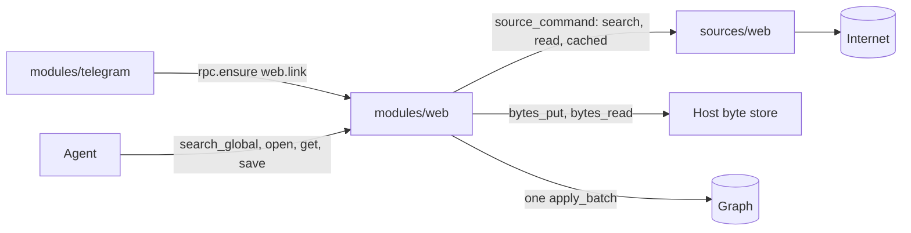

# Web as a catalog module: links, pages and an on-demand Source

Status: SPEC_DRAFT  
Spec lock: unlocked  
Implementation lock: unlocked  
Active Delivery: none  
Unattended decisions: allowed  

<!-- plan:spec:start -->
## The Goal

Make Web an ordinary catalog module, and treat a saved web page as a document on the same footing as a Telegram message or an email. Three actions are separated:

- **Register** a link found in a message.
- **Read** a page without writing to the Graph.
- **Save** exactly the content that was read, so evidence can cite it.

`modules/web` owns the `web.*` schemas and their Graph writes. `sources/web` owns the network. The host provides a byte store addressed by SHA-256 and the few contracts listed under *What the host provides*. The host side has its own plan, the app repository's `docs/plans/web-source.md`.

The currency is network work where none belongs, Graph writes on read, duplicate bytes, and host code that the catalog now owns:

- **Registration:** ingesting a message with URLs makes zero HTTP requests. Today each new URL triggers a preview fetch after commit.
- **Reading:** `search_global` and `open` write nothing to the Graph. Today `open` by `url` creates a `web.link` and merges the page text into its dictionary.
- **Saving:** a bounded batch is one `apply_batch` and returns real page UUIDs. The same content at the same URL keeps its page UUID; different content creates a new page; evidence on the old page stays readable.
- **Cache:** reopening a saved link within its HTTP freshness makes zero network requests.
- **Host code:** the native Web module (13 files, about 1,500 lines) leaves the host.
- **Existing data:** links keep their UUIDs and inbound links, and their stored text becomes pages.

## The target

One decision: every concern sits where the catalog already puts that kind of concern. The module owns the model and its writes, the Source owns the network, and the host owns bytes and transactions. A web page is declared like any other module's content.



### Model

| Schema | Properties | Anchor | `name` | Roles |
|---|---|---|---|---|
| `web.domain` | `{domain}` | `web:domain:<domain>` | the domain | — |
| `web.link` | `{url}` | `web:link:<url>` (unchanged) | the URL; existing names are kept | — |
| `web.page` | `{url, content_hash, mime_type, size_bytes}` | `web:page:<content_hash>:<url>` | the page title or `null` | `content` |

Field meanings:

- **`url`** is the normalized URL: http/https only, lowercase host, no fragment or userinfo, default port dropped.
- **`domain`** is the full host name: lowercase, punycode, with subdomains and `www` kept.
- **`content_hash`** is the SHA-256 of the stored bytes, as hex with no prefix.
- **`mime_type`** is `text/markdown`, because the stored bytes are the Markdown the agent saw.

Each entity is declared in `entities.ts` with `@magnis/declare`, like Telegram's and Email's messages:

- `web.page` declares `title` as its searched field, ordered by `date` (the first time the content was got).
- `web.link` and `web.domain` declare their names.

The generated `search`, `list` and `predicate` tools are therefore the Graph search over saved Web entities. The page body lives in the byte store, not in a property, so search finds pages by title and URL. Search over stored bodies is a separate later step, and so is a table of text descriptions keyed by content hash.

Links:

- `references`, any entity → `web.link`: the existing host kind. Telegram writes it.
- `child_of`, `web.link` → `web.domain`: the existing host kind. Domain membership is not identity and creates no company.
- `contents`, entity → an immutable snapshot of its content: a new general host kind (`*` → `*`). Web is its first user (`web.link` → `web.page`).

```typescript
interface ContentsMetadata {
  firstGet: string;             // first confirmed fetch of this content at this URL
  lastGet: string;              // last confirmed fetch (200 or 304)
  expires_at: string | null;    // freshness of that response, from Cache-Control max-age / Expires
  etag: string | null;          // validators of that response
  last_modified: string | null;
}
```

A page's dictionary never changes after creation; observations change only the `contents` metadata. A change of link metadata retires no claims, so evidence citing a page survives repeated saves. `firstGet` and `lastGet` do not prove the site was unchanged in between.

### Registering a link from a message

Telegram calls `rpc.ensure({schema_id: "web.link", items: [{url}]})` within its page transaction and links each message to the returned UUIDs with `references` in its own `apply_batch`. This is the `ensure` contract of contact identity (app PR #297): owner-routed, in the caller's root transaction. The Web handler works in four steps:

1. It normalizes the URLs.
2. It resolves every anchor of the batch in one `find_by_anchors` read.
3. It writes only the missing `web.link` rows, with their `web.domain` and `child_of`, in one `apply_batch`. Existing links enter that batch as refs, so their dictionaries are never rewritten.
4. It returns one `{ids: [linkId]}` per item, in input order.

No page, preview or image is fetched. A malformed URL is an error for the whole call, as `ensure` requires. Telegram passes only strings the platform URL parser accepts with an http or https scheme.

`graph.web_register`, `graph.web_register_batch` and the `web_register` grant disappear. Telegram does not work between the merge of this work and the merge of contact identity's `ensure`; the owner chose this, and both land in staging together.

### Search, read and save

| Tool | Behaviour | Writes |
|---|---|---|
| generated `search`/`list`/`predicate` on `web.*` | saved entities and link conditions | no |
| `search_global` on `web.link` | external search through the Source; links with the nil UUID and a snippet | no |
| `get` on `web.link` | a saved link with its domain, its pages with `ContentsMetadata`, and inbound `references` | no |
| `open` on `web.link` | read by `id` of a saved link or by `url` | no |
| `get` on `web.page` | a saved snapshot and a Markdown window from the byte store | no |
| `save` on `web.page` | pins the bytes that were read and saves up to 20 pages | yes |
| `save` on `web.link` | saves chosen search results as links (the `ensure` handling) | yes |

**Unsaved results.** The nil UUID `00000000-0000-0000-0000-000000000000` means "no Graph ID assigned". `save` and `ensure` refuse it as input and as a link end. A temporary and a saved result use the same shape, `CanonicalEntity`. For a temporary one, `createdAt` and `date` are the time the Source answered, and `source` is `{source: "web", account: <user>, externalId: <anchor>}`.

**`open`** checks ownership of the link before any network call, then takes one of two paths:

- **Fresh saved snapshot.** If the link has a saved page whose latest observation is fresh (`expires_at` later than now), that page comes from the byte store with its real UUID. There is no Source call.
- **Otherwise, or with `force_refresh`.** The Source `read`s the URL. The same hash is the saved page; a different hash is a new unsaved page.

Freshness is computed only by the Source, from the response headers; the module only compares `expires_at` with now. A response with no lifetime is stale at once, and no default lifetime is invented. `open` writes nothing, so only `save` persists a confirmation. Scheduled re-reading is a cron trigger that calls `open` and, when wanted, `save`.

**Windows.** Text comes in windows of at most 50 KiB. Every response states the full `size_bytes`, its `offset` and a `next_offset`, which is `null` once the end is reached, so a window never passes for the whole document. The tool descriptions tell the agent that large content is read in parts by passing `next_offset` back as `offset`.

**`save` on `web.page`** takes up to 20 `{url, content_hash}` and runs as one root transaction:

1. For each item, the module asks the Source for exactly those bytes (`cached`, no network).
2. It stores them with `bytes_put`; the host recomputes SHA-256 and the module refuses a mismatch.
3. It resolves anchors in one read.
4. It writes domains, links, pages and `contents` in one `apply_batch`. Within the transaction's owner fence, `firstGet = min` and `lastGet = max`; the freshness fields come from the observation with the greatest `lastGet`.

If the Source no longer holds the bytes, `save` says so and writes nothing. A re-fetch never substitutes for what was read. The bytes exist before the Graph refers to them; there is no distributed transaction, and unused bytes are not collected in this plan.

`save`, `ensure` and repair share one handling path in the module.

### The Web Source

`sources/web` needs no external account and has no background work. Its `magnis.execute` actions:

```typescript
interface WebSearchResult { url: string; title: string; snippet: string }

interface WebSourcePage extends ContentsMetadata {
  url: string;              // the requested URL; the redirect target is not reported
  title: string | null;
  mime_type: "text/markdown";
  content: string;          // complete Markdown, never truncated
  content_hash: string;     // SHA-256 of the UTF-8 Markdown, hex
  size_bytes: number;
}

// search {query, limit 1..10}       → { results: WebSearchResult[] }   DuckDuckGo HTML, as the host does today
// read   {url, force_refresh}       → WebSourcePage                    network or HTTP cache
// cached {url, content_hash}        → WebSourcePage                    cache only; ConnectorError "not_cached" otherwise
```

- **HTTP:**
  - at most 4 redirects;
  - a private or reserved address is refused at every hop;
  - `Cache-Control: max-age` / `Expires` freshness, then `ETag` / `Last-Modified` revalidation;
  - `force_refresh` skips both;
  - a response with no lifetime gets `expires_at = null`.
- **Conversion:**
  - `@mozilla/readability` over a `linkedom` document;
  - `turndown` with `turndown-plugin-gfm`, which keeps headings, lists, tables, code blocks and link URLs;
  - no LLM;
  - nothing time-dependent enters the Markdown, so the same HTML yields the same hash.
- **Limits:**
  - a body over 4 MiB is `ConnectorError` kind `too_large`; the limit fits the host's 8 MiB plugin frame and there is never a partial page;
  - every request is bounded at 20 s, under the host's 30 s action deadline;
  - a 429 becomes `RateLimitError` with `Retry-After`.
- **Cache:**
  - kept in process memory and bounded at 64 MiB, with least-recently-used eviction;
  - it keeps validators per URL and Markdown per content hash;
  - a cache hit never moves `lastGet`, while a `304` does.
- **Certification:**
  - no `[auth]`;
  - `authority = module_sync`, `delivery = none`;
  - one surface `web`, received by `modules/web`;
  - callable `magnis.execute:search`, `:read` and `:cached`.

### What the host provides

The app plan delivers these; this plan only uses them:

- **Byte store operations:**
  - `bytes_put({text}) → {content_hash, size_bytes}`;
  - `bytes_read({entity_id, offset, length}) → {text, offset, length, size_bytes}`, which reads only through an entity of the calling user that carries `content_hash`, with the window cut on a UTF-8 boundary;
  - `byte_objects`, the store's record of each object (hash, size, first-stored time), which supplies `size_bytes`;
  - the grant `host = ["bytes"]`.
- **On-demand Sources.** `module_sync` with `delivery = none` is reached only through `magnis.execute`. Each user gets an account without credentials whose id is the Source id (`web`). A module may command such a surface that it declares in `[surfaces.web]`, with no sync handler.
- **The `contents` host link kind** and its metadata schema.
- **The agent verbs `search_global` and `save`.**
- **Removal of the native Web module.** Installing `modules/web` takes over the `web.link` schema; the host already upserts a module's schemas with the module as owner.
- **From contact identity:** `rpc.ensure`, nested dispatch and the root transaction for module RPC.

### Existing data

`web.repair` is a bounded, explicit RPC of the module that is safe to repeat, like repair in contact identity. It runs each link that still has an old dictionary through the shared handling:

- it adds the domain and `child_of`;
- it stores `content.content_markdown` with `bytes_put`, creates the `web.page`, and gives `contents` `firstGet = lastGet = content.extracted_at`;
- it rewrites the dictionary to `{url}`, taking `url` from the anchor, because preview enrichment overwrote `properties.url` with the post-redirect address.

Link UUIDs and inbound links do not change. Dates come only from the data: a link with text but no `extracted_at` fails repair explicitly, and the migration time is never substituted. Text cut by the old 50 KiB limit is kept as it is, marker `[content truncated]` included. The preview fields `description`, `favicon_url` and `og_image_url` are dropped; only Web tools read them.

### Target tree

```text
modules/web/manifest.toml                    identity, [surfaces.web], [permissions] links/host/call
modules/web/entities.ts                      web.domain, web.link, web.page declarations
modules/web/entities.test.ts                 written entities parse against the declarations
modules/web/types.ts                         WebPageRead, ContentsMetadata, tool results
modules/web/schema.ts                        anchors and ids
modules/web/module/index.ts                  definePlugin
modules/web/module/service.ts                ensure, search_global, open, get, save, repair
modules/web/module/helpers.ts                normalization, windows, batch building
modules/web/module/__tests__/                registration, read, save, repair behaviour
modules/web/ui/index.tsx                     module definition and save result cards
modules/web/{package.json,tsconfig.json,README.md,icon.svg}
sources/web/manifest.toml                    certification, callable operations
sources/web/package.json                     linkedom, @mozilla/readability, turndown, turndown-plugin-gfm
sources/web/src/{main.ts,connector.ts,http.ts,cache.ts,markdown.ts,search.ts}
sources/web/src/*.test.ts                    behaviour with an injected fetch; stdio certification
scripts/certify-sources.ts                   module_sync with delivery none
scripts/test-connectors.sh                   runs sources/web
modules/telegram/module/service.ts           ensure web.link, references by UUID
modules/telegram/manifest.toml               call web.ensure, links references, no web_register
modules/telegram/**/__tests__/               ingest, links and routing tests
packages/plugin-sdk/contract/module.ts       bytes_put, bytes_read; web_register removed
packages/host-stubs/types/                   regenerated from the host SDK
plugins/onboarding.toml                      Web offered with the system modules
docs/plugins/{source.md,module.md}           on-demand delivery; content in the byte store
```

## Today, measured against that

On catalog `8f1e371` and app `fe2e0174c`:

- The Web module is native to the host: 13 files and about 1,500 lines in the app's `backend/src/services/web`. Its only caller in the catalog is Telegram: `modules/telegram/module/service.ts:404-409` builds `web_register` rows, `:1491` sends them with `graph.web_register_batch`, and the grant sits at `modules/telegram/manifest.toml:39`.
- `packages/plugin-sdk/contract/module.ts:360-374` declares `web_register(_batch)` "with background preview fetch". The module contract has no byte operation (`:336-456`), and `RpcExecutor` has only `execute` (`:475-477`).
- No catalog Source fetches generic web pages or parses HTML. The lockfile has no readability, turndown, linkedom or cheerio.
- `scripts/certify-sources.ts:642-644` refuses `module_sync` with `delivery = none`.
- `scripts/build-plugins.ts:185-188` requires `ui/index.tsx` in every module, so `modules/web` ships a minimal UI.

### Reuse map

- **`email.ensure_address`** (`modules/email/module/service.ts:786-856`) is the find-or-create shape in the catalog today: an anchored `apply_batch` behind an `@rpc`. Web's `ensure` follows it under the general contract.
- **`@magnis/declare`** with its generated `search`/`list`/`predicate` is the Graph search for saved Web entities; no hand-written search is added.
- **`graph.source_command`** reaches the Source; Telegram's send already uses it.
- **`runConnector`, `ConnectorError`, `RateLimitError`, `mockFetch`, `runSourceContract`** and the certification harness carry the Source.
- **The testkit's `mockGraph` and `mountModule`** carry the module tests.
- **Graph anchors** with a unique index de-duplicate links, domains and pages under concurrency; the module adds no uniqueness of its own.

## New names

| Name | Why |
|---|---|
| `modules/web`, `sources/web` | The Web module moves into the catalog; the network moves into its Source. |
| `web.domain`, `web.page` | Schemas of a domain and of saved content; `web.page` stops being a schema-less resource. |
| `contents`, `ContentsMetadata` | General host link "entity → immutable snapshot"; its metadata is the observation. |
| `search_global`, `save` | Agent verbs for external search and for saving results. |
| `WebPageRead` | What `open` and `web.page.get` return: entity, Markdown window, `offset`, `next_offset`, `ContentsMetadata`. |
| `next_offset` | Where the next window starts, or `null` at the end. |
| `WebSourcePage`, `search`, `read`, `cached`, `not_cached`, `too_large` | The Source's result, actions and typed errors. |
| `bytes_put`, `bytes_read` | Module operations on the host byte store. |
| `web.repair` | Explicit bounded repair of existing links. |

## Invariants

1. Ingesting a message with URLs writes `web.link`, `web.domain` and `child_of` in the page transaction with no HTTP request.
2. Repeated and concurrent `ensure` of one URL returns the same UUID and creates no second link or domain. An existing link's dictionary is never rewritten by `ensure`. A malformed URL fails the whole call.
3. `search_global` and `open` write nothing; unsaved results carry the nil UUID. `save` and `ensure` refuse the nil UUID.
4. `open` of a link the user does not own fails before any network call.
5. `open` of a saved link whose latest page is fresh makes no Source call. A stale page, `force_refresh` or a response without a lifetime goes to the Source.
6. Two saves of the same content at the same URL, sequential or concurrent, give one `web.page` and one `contents` link. `firstGet` is the minimum and `lastGet` the maximum; the freshness fields come from the latest observation.
7. Changed content creates a new `web.page`. The old page, its bytes and evidence on it remain readable, and a repeated save retires no claim citing a page.
8. `save` stores the bytes the agent read even if the site now serves something else. If they are gone, `save` fails and writes nothing. A host hash that differs from the claimed one fails the save.
9. Every text window carries `size_bytes`, `offset` and `next_offset`. Reading by `next_offset` until it is `null` returns exactly the stored text.
10. The Source returns Markdown that keeps headings, lists, a table, a code block and link URLs; the same HTML yields the same hash. A body over 4 MiB is `too_large` with nothing cached.
11. A redirect to a private or reserved address is refused before it is followed. A request past its bound fails with a typed timeout; a 429 is `-32002` with `retry_after`.
12. A fresh Source cache entry answers with no request and the same `lastGet`. A `304` returns the cached page with a newer `lastGet`. `cached` never makes a request.
13. The certifier accepts `module_sync` with `delivery = none` and still refuses `tools_only` with any other delivery.
14. `web.repair` keeps link UUIDs and inbound links, adds domains, and turns stored text into pages with dates only from `extracted_at`; a missing date fails. Running it again changes nothing.

## Owner decisions

Recorded on 2026-10-01:

- **Web is a regular catalog module.** Uniform structure lets a web page be treated as a document like any other content.
- **The host keeps the byte store** as a core service.
- **Registration builds on `ensure` now.** Telegram does not work until contact identity's `ensure` lands, and both merge into staging together.
- **A page relates to its link through `contents`**, with `firstGet`/`lastGet` in the metadata. `contents` is a general link, not a Web-only one.
- **Cache freshness is inherited from HTTP**, so a fresh saved page is not re-checked.
- **No background re-checks or downloads.** Scheduled re-reading is a cron trigger.

Proposed here and confirmed by approving this SPEC:

- `child_of` for link → domain;
- the extraction libraries;
- the 4 MiB page limit;
- dropping the preview fields;
- storing Markdown, not the raw HTTP response;
- search over stored page bodies, and descriptions of stored bytes, are left for later.

## Constraints and exclusions

- Contacts, companies, enrichment and merge are out of scope.
- Email does not start extracting URLs.
- No background downloads, re-checks or link crawling, and no fetching of page images or attachments.
- No raw HTTP response is stored.
- No garbage collection of bytes.
- The Source always refuses private addresses. Intranet pages opened today through the host's `ALLOW_PRIVATE_URLS` stop opening.
- The redirect target is not stored; a page belongs to the requested URL.

## The pre-approval screen

### What changes

The catalog gains `modules/web` (model, tools, `ensure`, repair) and `sources/web` (search, HTTP, cache, Markdown). Telegram registers URLs through `ensure`. The certifier accepts on-demand Sources, and the SDK gains the byte operations and loses `web_register`. The host plan adds the byte store, on-demand Sources, `contents` and the two verbs, moves File onto the byte store, and deletes the native Web module.

### Acceptance stories

1. A Telegram message containing `https://example.com/a?b` syncs, and the message references a `web.link` for that URL, which is `child_of` the `web.domain` `example.com`. No network call happens.
2. The agent searches "example", gets links with nil UUIDs, opens one and sees a title and Markdown; nothing appears in the Graph.
3. The agent saves the page and gets its UUID. The site changes, and the agent opens and saves again: a second page appears, and the agent's statement citing the first page stays valid.
4. When the site serves the old content again, saving returns the first page's UUID and moves its `lastGet`.
5. Reopening the saved link while its page is fresh answers from storage without the network.
6. Saving a page whose bytes the Source already evicted reports it and writes nothing.
7. After the upgrade, `web.repair` turns every link with old text into a link, a domain and a page, keeping the link's UUID.

### Deliberately not verified

- **Live sites and DuckDuckGo:** the tests use an injected `fetch`.
- **Telegram end to end before contact identity's `ensure` lands:** by the owner's decision.
- **Full-text search over page bodies:** a later step.
<!-- plan:spec:end -->

<!-- plan:implementation:start -->
## Implementation contract
<!-- plan:implementation:end -->

<!-- plan:execution:start -->
## Execution log
<!-- plan:execution:end -->
