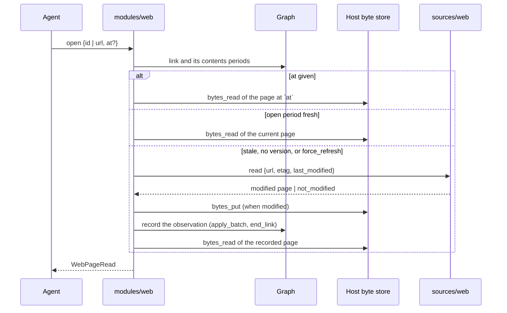
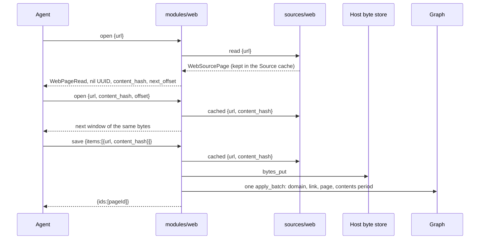

# Web as a catalog module: links, pages and an on-demand Source

Status: SPEC_DRAFT  
Spec lock: unlocked  
Implementation lock: unlocked  
Active Delivery: none  
Unattended decisions: allowed  

<!-- plan:spec:start -->
## The Goal

Make Web an ordinary catalog module, and treat a saved web page as a document on the same footing as a Telegram message or an email. Three actions are separated:

- **Register** a link found in a message.
- **Read** a link. A link already in the Graph keeps its own version history current; an unknown URL is read without writing and comes back with the nil UUID.
- **Save** exactly the content that was read from an unknown URL, so evidence can cite it.

`modules/web` owns the `web.*` schemas and their Graph writes. `sources/web` owns the network. The host provides a byte store addressed by SHA-256 and the contracts listed under *What the host provides*. The host side has its own plan, the app repository's `docs/plans/web-source.md`.

The currency is network work where none belongs, Graph writes on read, duplicate bytes, and host code that the catalog now owns:

- **Registration:** ingesting a message with URLs makes zero HTTP requests. Today each new URL triggers a preview fetch after commit.
- **Reading:**
  - `search_global`, and `open` of a URL not in the Graph, write nothing;
  - `open` of a link in the Graph answers from its history while fresh, and records a new version only when the content changed;
  - today `open` by `url` creates a `web.link` and merges the page text into its dictionary, overwriting the previous text.
- **Saving:** a bounded batch is one `apply_batch` and returns real page UUIDs. The same content at the same URL keeps its page UUID; different content creates a new page; evidence on the old page stays readable.
- **Cache:** reopening a saved link within its HTTP freshness makes zero network requests.
- **History:** asking a link for its content at a past moment returns the version observed then, with no network request.
- **Host code:** the native Web module (13 files, about 1,500 lines) leaves the host.
- **Existing data:** links keep their UUIDs and inbound links, and their stored text becomes pages.

## The target

One decision: every concern sits where the catalog already puts that kind of concern. The module owns the model and its writes, the Source owns the network, and the host owns bytes and transactions. A web page is declared like any other module's content, and its history uses the Graph's own link periods.


### Model

| Schema | Properties | Anchor | `name` | Roles |
|---|---|---|---|---|
| `web.domain` | `{domain}` | `web:domain:<domain>` | the domain | — |
| `web.link` | `{url}` | `web:link:<url>` (unchanged) | the URL; existing names are kept | — |
| `web.page` | `{url, content_hash, mime_type, size_bytes}` | `web:page:<content_hash>:<url>` | the page title or `null` | `content` |

Field meanings:

- **`url`** is the normalized URL: http/https only, lowercase host, no fragment or userinfo, default port dropped.
- **`domain`** is the full host name: lowercase, punycode, with subdomains and `www` kept.
- **`content_hash`** is the SHA-256 of the stored bytes, as hex with no prefix.
- **`mime_type`** is `text/markdown`, because the stored bytes are the Markdown the agent saw.

Each entity is declared in `entities.ts` with `@magnis/declare`, like Telegram's and Email's messages:

- `web.page` declares its title as the searched field, ordered by `date` (the first time the content was recorded).
- `web.link` and `web.domain` declare their names.

The generated `search`, `list` and `predicate` tools are therefore the Graph search over saved Web entities. The page body lives in the byte store, not in a property, so search finds pages by title and URL. Search over stored bodies is a separate later step, and so is a table of text descriptions keyed by content hash.

Links:

- `references`, any entity → `web.link`: the existing host kind. Telegram writes it.
- `child_of`, `web.link` → `web.domain`: the existing host kind. Domain membership is not identity and creates no company.
- `contents`, entity → an immutable snapshot of its content: a new general host kind (`*` → `*`). Web is its first user (`web.link` → `web.page`).

### Versions are `contents` periods

A `contents` link is a Graph link with the Graph's own period: `validFrom` and `validUntil`, never overlapping for the same link and page. One period means "from `validFrom` the URL served this page's content"; its metadata carries the observation:

```typescript
interface ContentsMetadata {
  lastGet: string;              // last confirmed fetch of this content within this period (200 or 304)
  expires_at: string | null;    // freshness of that response
  etag: string | null;          // validators of that response
  last_modified: string | null;
}
```

The owner's `firstGet` is the period's `validFrom`; `lastGet` is in the metadata. A page's dictionary never changes after creation. Observations change only `contents` periods and metadata. A change to a link's metadata or period retires no claims, so evidence citing a page survives every later observation. `firstGet` and `lastGet` do not prove the site was unchanged in between.

The current version of a link is the page whose `contents` period is open (`validUntil` null). A link has at most one open period.

**Recording an observation** of content X at time T on link L. Both `save` and `open` record observations, through the same module code, inside one root transaction under the owner fence:

1. **X is L's current version:** the open period's `lastGet` becomes `max(lastGet, T)`, and the freshness fields come from the newer observation. `validFrom` does not move.
2. **T is later than every observation on L, or L has none:**
   - the open period, if any, ends at T (`end_link`);
   - X gets a new period starting at T (`apply_batch` with `validFrom = T`);
   - X's page is created if the content is new, or reused if X was a version of L before.
3. **Otherwise the observation is older than L's recorded history and names other content:**
   - if X is already a version of L, its page is returned and nothing changes;
   - if not, the call fails with "the link has newer observations; open it again". A newer observation is never silently overwritten by an older one.

**A version at a moment `at`** is the page of the period with the greatest `validFrom` not later than `at`. If no period starts at or before `at`, the call fails with "no snapshot at or before `at`". With observations A at t1, B at t2 and A at t3, the periods are A [t1, t2), B [t2, t3) and A [t3, open), so every moment maps to the content last seen to change before it.

### Flows

Every flow runs in `modules/web` unless stated otherwise. The RED commands use the catalog lane `bun run agent:test:backend -- <file> -t <test id>`.

| Flow | Owner | Target files | Input / wake | Output / durable state | RED test |
|---|---|---|---|---|---|
| F1 Register links from a message | `modules/web` `ensure`; `modules/telegram` caller | `modules/web/module/service.ts`, `modules/web/module/helpers.ts`, `modules/telegram/module/service.ts` | Telegram sync page with URLs in message text | `web.link`, `web.domain`, `child_of`, `references` in the page transaction; no HTTP | `modules/web/module/__tests__/ensure.test.ts -t tst_web_001`; `modules/telegram/module/__tests__/telegramIngest.test.ts -t tst_tg_web_001` |
| F2 Open a link in the Graph | `modules/web` `open` | `modules/web/module/service.ts`, `modules/web/module/helpers.ts` | agent `open {id}` or `open {url}` of a known URL | current version from the byte store, or a recorded observation and new period | `modules/web/module/__tests__/open.test.ts -t tst_web_010` |
| F3 Open an unknown URL | `modules/web` `open` | `modules/web/module/service.ts` | agent `open {url}`, URL not in the Graph | `WebPageRead` with the nil UUID; nothing written | `modules/web/module/__tests__/open.test.ts -t tst_web_020` |
| F4 Read a past version | `modules/web` `open` | `modules/web/module/service.ts` | agent `open {id, at}` | the version at `at`; nothing written | `modules/web/module/__tests__/history.test.ts -t tst_web_030` |
| F5 Continue a window | `modules/web` `open`, `get` | `modules/web/module/service.ts`, `modules/web/module/helpers.ts` | `next_offset` plus `content_hash` (unsaved) or page `id` (saved) | the next window of the same bytes | `modules/web/module/__tests__/window.test.ts -t tst_web_040` |
| F6 Save an unknown URL's read | `modules/web` `save` | `modules/web/module/service.ts` | agent `save {items: [{url, content_hash}]}` | bytes in the store; domain, link, page and `contents` period in one `apply_batch` | `modules/web/module/__tests__/save.test.ts -t tst_web_050` |
| F7 External search | `modules/web` `search_global`; `sources/web` `search` | `modules/web/module/service.ts`, `sources/web/src/search.ts` | agent `search_global {query, limit}` | links with the nil UUID and snippets; nothing written | `sources/web/src/search.test.ts -t tst_web_src_001`; `modules/web/module/__tests__/search.test.ts -t tst_web_060` |
| F8 Source read | `sources/web` | `sources/web/src/{http.ts,cache.ts,markdown.ts,connector.ts}` | `magnis.execute` `read`/`cached` | `WebSourcePage` or `not_modified`; in-memory cache entry | `sources/web/src/http.test.ts -t tst_web_src_010`; `sources/web/src/markdown.test.ts -t tst_web_src_020`; `sources/web/src/cache.test.ts -t tst_web_src_030` |
| F9 Repair existing links | `modules/web` `web.repair` | `modules/web/module/service.ts` | explicit RPC call, bounded by `limit` | domain, page and period per old link; dictionary `{url}` | `modules/web/module/__tests__/repair.test.ts -t tst_web_070` |
| F10 File stores bytes by hash | `modules/file` declaration and helpers | `modules/file/entities.ts`, `modules/file/types.ts`, `modules/file/module/helpers.ts` | host writes `content_hash` on download, upload and repair | `file.object` validates with `content_hash`; availability by `content_hash` | `modules/file/entities.test.ts -t tst_file_hash_001`; `modules/file/module/__tests__/fileModule.test.ts -t tst_file_hash_002` |
| F11 On-demand Source certified | `scripts/certify-sources.ts`, `packages/testkit`, `packages/connector-sdk` | see Target tree | certification of `sources/web` | receipt with `module_sync`, `delivery = none`, no auth | `scripts/certify-sources.test.ts -t tst_cert_on_demand_001`; `packages/testkit/__tests__/tst_cat_src_cert_001.test.ts -t tst_cert_on_demand_002`; `sources/web/src/certification.test.ts -t tst_web_src_cert_001` |

F1, register links from a message:

```mermaid
sequenceDiagram
    participant TG as modules/telegram
    participant H as Host (ensure routing)
    participant W as modules/web
    participant G as Graph
    TG->>H: rpc.ensure web.link [{url}]
    H->>W: web.ensure (same root transaction)
    W->>G: find_by_anchors (one read)
    W->>G: apply_batch: new links, domains, child_of; existing links as refs
    W-->>TG: [{ids:[linkId]}]
    TG->>G: apply_batch: messages, references by UUID ref
```

F2 and F4, open a link in the Graph:



F3, F5 and F6, an unknown URL read, continued and saved:



F7, F9, F10 and F11 are single calls whose implementation map is complete in the table.

### Registering a link from a message

Telegram calls `rpc.ensure({schema_id: "web.link", items: [{url}]})` within its page transaction. It links each message to the returned UUIDs with `references` in its own `apply_batch`, using a ref by UUID. Both `ensure` and UUID batch refs are contact identity's contract (app PR #297, with its catalog half): owner-routed, in the caller's root transaction. The Web handler works in four steps:

1. It normalizes the URLs.
2. It resolves every anchor of the batch in one `find_by_anchors` read.
3. It writes only the missing `web.link` rows, with their `web.domain` and `child_of`, in one `apply_batch`. Existing links enter that batch as refs, so their dictionaries are never rewritten.
4. It returns one `{ids: [linkId]}` per item, in input order.

No page, preview or image is fetched. A malformed URL is an error for the whole call, as `ensure` requires. Telegram passes only strings the platform URL parser accepts with an http or https scheme.

`graph.web_register`, `graph.web_register_batch` and the `web_register` grant disappear. Telegram does not work between the merge of this work and the merge of contact identity's `ensure`; the owner chose this, and both land in staging together.

### Search, read and save

| Tool | Behaviour | Writes |
|---|---|---|
| generated `search`/`list`/`predicate` on `web.*` | saved entities and link conditions | no |
| `search_global` on `web.link` | external search through the Source; links with the nil UUID and a snippet | no |
| `get` on `web.link` | a saved link with its domain, its versions (`contents` periods with their pages, by `validFrom`), and inbound `references` | no |
| `open` on `web.link`, a link in the Graph (`id`, or a `url` that exists) | its current version, refreshed when stale; with `at`, the version at that moment | yes, when a refresh records an observation |
| `open` on `web.link`, a `url` not in the Graph | read through the Source; a page with the nil UUID | no |
| `get` on `web.page` | a saved snapshot and a Markdown window from the byte store | no |
| `save` on `web.page` | pins the bytes read from unknown URLs and saves up to 20 pages | yes |
| `save` on `web.link` | saves chosen search results as links (the `ensure` handling) | yes |

**Unsaved results.** The nil UUID `00000000-0000-0000-0000-000000000000` means "no Graph ID assigned". `save` and `ensure` refuse it as input and as a link end. A temporary and a saved result use the same shape, `CanonicalEntity`. For a temporary one, `createdAt` and `date` are the time the Source answered, and `source` is `{source: "web", account: <user>, externalId: <anchor>}`.

**`open` of a link in the Graph** (by `id`, or by a `url` whose anchor exists) checks ownership before any network call. Then one of these happens:

- **`at` given:** the version at `at` comes from the byte store. There is no network call and no write.
- **The open period is fresh** (`expires_at` later than now) and there is no `force_refresh`: the current version comes from the byte store. There is no Source call and no write.
- **No version yet** (for example a link that came from a message), **stale**, or **`force_refresh`:**
  1. The Source `read`s the URL with the current version's `etag` and `last_modified`, if there is a current version.
  2. A new hash is stored with `bytes_put`.
  3. The observation is recorded by the rule above: `not_modified` and a known hash move the current period, while a new or returning hash opens a period.

The agent is told none of this: it calls `open` and gets the current content.

**`open` of a URL not in the Graph:** the Source `read`s it, and the answer is a page with the nil UUID. Nothing is written; the agent may `save` it.

Freshness is computed only by the Source, from the response headers; the module only compares `expires_at` with now. Scheduled re-reading of a saved link is a cron trigger that calls `open`.

**Windows.**
- Text comes in windows of at most 50 KiB.
- Every response states the full `size_bytes`, its `offset` and a `next_offset`, which is `null` once the end is reached, so a window never passes for the whole document.
- A window continues the same bytes:
  - a saved page continues with `web.page` `get {id, offset}`;
  - an unsaved page continues with `open {url, content_hash, offset}`, which reads only the Source cache (`cached`) and fails with `not_cached` once the bytes are evicted. It never refreshes, so windows of different versions never mix.
- The tool descriptions tell the agent that large content is read in parts this way.

**`save` on `web.page`** takes up to 20 `{url, content_hash}` and runs as one root transaction:

1. For each item, the module asks the Source for exactly those bytes (`cached`, no network).
2. It stores them with `bytes_put`; the host recomputes SHA-256 and the module refuses a mismatch.
3. It resolves anchors in one read.
4. It records each observation by the rule above, in one `apply_batch` for domains, links, pages and new periods, plus `end_link` for periods it closes.

If the Source no longer holds the bytes, `save` says so and writes nothing. A re-fetch never substitutes for what was read. The bytes exist before the Graph refers to them; there is no distributed transaction, and unused bytes are not collected in this plan.

`save`, `ensure`, the observations recorded by `open`, and repair share one handling path in the module.

### The Web Source

`sources/web` needs no external account, has no sync surface work and no background work. Its `magnis.execute` actions:

```typescript
interface WebSearchResult { url: string; title: string; snippet: string }

interface WebSourcePage extends ContentsMetadata {
  url: string;              // the requested URL; the redirect target is not reported
  fetched_at: string;       // when this response was received (the observation time T)
  title: string | null;
  mime_type: "text/markdown";
  content: string;          // complete Markdown, never truncated
  content_hash: string;     // SHA-256 of the UTF-8 Markdown, hex
  size_bytes: number;
}

// search {query, limit 1..10}            → { results: WebSearchResult[] }   DuckDuckGo HTML, as the host does today
// read   {url, force_refresh, etag?, last_modified?}
//        → { status: "modified", page: WebSourcePage }
//        | { status: "not_modified", fetched_at: string, metadata: ContentsMetadata }   only when validators were passed and the server answered 304
// cached {url, content_hash}             → WebSourcePage                    cache only; ConnectorError "not_cached" otherwise
```

- **HTTP:**
  - at most 4 redirects;
  - a private or reserved address is refused at every hop;
  - validators passed by the module mean a conditional request: the module has already decided the version is stale, so the Source's own cache is not consulted;
  - `force_refresh` skips the cache and validators.
- **Freshness**, computed once here as `expires_at`:
  - `Cache-Control: no-store` or `no-cache` gives `expires_at = null`, so the content is never served as fresh;
  - otherwise `max-age` minus the response's `Age` gives the lifetime;
  - without `max-age`, `Expires` minus `Date` gives it;
  - with neither, `expires_at = null` — no heuristic or default lifetime is invented;
  - a cached copy that is the agent's own read (kept for `cached` and window continuation) is not an answer to a fresh request, so `no-store` does not prevent `save`.
- **Conversion:**
  - `@mozilla/readability` over a `linkedom` document;
  - `turndown` with `turndown-plugin-gfm`, which keeps headings, lists, tables, code blocks and link URLs;
  - no LLM;
  - control characters other than newline and tab are removed;
  - nothing time-dependent enters the Markdown, so the same HTML yields the same hash.
- **Limits:**
  - a response body over 8 MiB is `ConnectorError` kind `too_large`;
  - converted Markdown over 3 MiB is `too_large` too, never a partial page. With only newline, tab, quote and backslash left to escape, JSON at most doubles the text: 6 MiB plus the envelope fits the host's 8 MiB plugin frame and its 3 MiB `bytes_put` limit;
  - one whole `read` or `search` action — every redirect hop and the conversion — is bounded at 20 s, under the host's 30 s action deadline, and surfaces a typed timeout;
  - a 429 becomes `RateLimitError` with `Retry-After`.
- **Cache:**
  - serves reads of URLs that are not in the Graph, window continuation and `cached`;
  - kept in process memory and bounded at 64 MiB, with least-recently-used eviction;
  - it keeps validators per URL and Markdown per content hash;
  - a cache hit never moves `lastGet`, while a `304` does.
- **Connector:**
  - `sources/web` has no `fetch` handler;
  - `connector-sdk` lets such a connector omit `fetch`, advertise no sync capability, and answer `magnis.sync.fetch` with method-not-found.
- **Certification:**
  - no `[auth]`;
  - `authority = module_sync`, `delivery = none`;
  - one surface `web`, received by `modules/web`;
  - callable `magnis.execute:search`, `:read` and `:cached`;
  - no `magnis.sync.fetch`.

### What the host provides

The app plan delivers these; this plan only uses them:

- **Byte store operations:**
  - `bytes_put({text}) → {content_hash, size_bytes}` for text of at most 3 MiB;
  - `bytes_read({entity_id, offset, length}) → {text, offset, length, size_bytes}`, which reads only through an entity of the calling user that carries `content_hash`, with the window cut on a UTF-8 boundary;
  - `byte_objects`, the store's record of each object (hash, size, first-stored time), which supplies `size_bytes`;
  - the grant `host = ["bytes"]`.
- **On-demand Sources.** `module_sync` with `delivery = none` is reached only through `magnis.execute`. Each user gets an account without credentials whose id is the Source id (`web`). A module may command such a surface that it declares in `[surfaces.web]`, with no sync handler.
- **The `contents` host link kind** and its `ContentsMetadata` schema.
- **The agent verbs `search_global` and `save`.**
- **File bytes by hash:** `file.object` gains `content_hash` in place of `local_path` after download, upload and `file.repair`.
- **Removal of the native Web module.** Installing `modules/web` takes over the `web.link` schema; the host already upserts a module's schemas with the module as owner.
- **From contact identity** (app PR #297 and its catalog half):
  - `rpc.ensure`;
  - nested dispatch;
  - the root transaction for module RPC;
  - UUID batch refs (`BatchRefInput` with an `id`).

### Existing data

`web.repair` is a bounded, explicit RPC of the module that is safe to repeat, like repair in contact identity. It runs each link that still has an old dictionary through the shared handling:

- it adds the domain and `child_of`;
- it stores `content.content_markdown` with `bytes_put`, creates the `web.page`, and records one observation at `content.extracted_at`;
- it rewrites the dictionary to `{url}`, taking `url` from the anchor, because preview enrichment overwrote `properties.url` with the post-redirect address.

Link UUIDs and inbound links do not change. Dates come only from the data: a link with text but no `extracted_at` fails repair explicitly, and the migration time is never substituted. Text cut by the old 50 KiB limit is kept as it is, marker `[content truncated]` included. The preview fields `description`, `favicon_url` and `og_image_url` are dropped; only Web tools read them.

### Target tree

```text
CREATE modules/web/manifest.toml                     identity, [surfaces.web], [permissions] links/host/call
CREATE modules/web/entities.ts                       web.domain, web.link, web.page declarations
CREATE modules/web/entities.test.ts                  written entities parse against the declarations
CREATE modules/web/types.ts                          WebPageRead, ContentsMetadata, tool results
CREATE modules/web/schema.ts                         anchors and ids
CREATE modules/web/module/index.ts                   definePlugin
CREATE modules/web/module/service.ts                 ensure, search_global, open, get, save, repair
CREATE modules/web/module/helpers.ts                 normalization, observation rule, windows, batch building
CREATE modules/web/module/__tests__/ensure.test.ts   F1
CREATE modules/web/module/__tests__/open.test.ts     F2, F3
CREATE modules/web/module/__tests__/history.test.ts  F4
CREATE modules/web/module/__tests__/window.test.ts   F5
CREATE modules/web/module/__tests__/save.test.ts     F6
CREATE modules/web/module/__tests__/search.test.ts   F7
CREATE modules/web/module/__tests__/repair.test.ts   F9
CREATE modules/web/ui/index.tsx                      module definition and save result cards
CREATE modules/web/package.json
CREATE modules/web/tsconfig.json
CREATE modules/web/README.md
CREATE modules/web/icon.svg
CREATE sources/web/manifest.toml                     certification, callable operations
CREATE sources/web/package.json                      linkedom, @mozilla/readability, turndown, turndown-plugin-gfm
CREATE sources/web/tsconfig.json                     so the typecheck script covers the Source
CREATE sources/web/README.md
CREATE sources/web/src/main.ts                       runConnector entry
CREATE sources/web/src/connector.ts                  execute table: search, read, cached
CREATE sources/web/src/http.ts                       bounded fetch, redirects, private-address refusal, freshness
CREATE sources/web/src/cache.ts                      per-URL validators, per-hash Markdown, LRU bound
CREATE sources/web/src/markdown.ts                   extraction and Markdown
CREATE sources/web/src/search.ts                     DuckDuckGo HTML parsing
CREATE sources/web/src/http.test.ts                  F8 HTTP, freshness, limits
CREATE sources/web/src/markdown.test.ts              F8 conversion
CREATE sources/web/src/cache.test.ts                 F8 cache
CREATE sources/web/src/search.test.ts                F7
CREATE sources/web/src/certification.test.ts         F11 stdio certification of the real bundle
MODIFY bun.lock                                      the four new dependencies
MODIFY packages/connector-sdk/contract/source.ts     `fetch` optional for an on-demand connector
MODIFY packages/connector-sdk/index.ts               no sync capability without `fetch`
MODIFY packages/connector-sdk/index.test.ts          on-demand connector behaviour
MODIFY packages/testkit/source.ts                    contract run without a fetch drain
MODIFY packages/testkit/receipt.ts                   module_sync with delivery none, production without auth for it
MODIFY packages/testkit/__tests__/tst_cat_src_cert_001.test.ts  F11 receipt rules
MODIFY scripts/certify-sources.ts                    delivery none under module_sync; no fetch requirement for it
MODIFY scripts/certify-sources.test.ts               F11 certifier rules
MODIFY scripts/test-connectors.sh                    runs sources/web
MODIFY modules/telegram/module/service.ts            ensure web.link, references by UUID ref
MODIFY modules/telegram/module/helpers.ts            URL extraction keeps only http/https URLs the parser accepts
MODIFY modules/telegram/manifest.toml                call web.ensure, links references, no web_register
MODIFY modules/telegram/module/__tests__/telegramIngest.test.ts  F1 caller side
MODIFY modules/telegram/module/__tests__/messagesGetLinks.test.ts  links read through references
MODIFY modules/telegram/module/__tests__/mediaSourceRouting.test.ts  no web_register op in the mock graph
MODIFY modules/telegram/entities.test.ts             no web_register op in the mock graph
MODIFY modules/file/entities.ts                      content_hash in place of local_path
MODIFY modules/file/types.ts                         content_hash in place of local_path
MODIFY modules/file/module/helpers.ts                availability and serving by content_hash
MODIFY modules/file/entities.test.ts                 F10 declaration
MODIFY modules/file/module/__tests__/fileModule.test.ts  F10 availability
MODIFY packages/plugin-sdk/contract/module.ts        bytes_put, bytes_read; web_register and web_register_batch removed
MODIFY packages/host-stubs/types/                    regenerated from the host SDK
MODIFY plugins/onboarding.toml                       Web offered with the system modules
MODIFY docs/plugins/source.md                        on-demand delivery
MODIFY docs/plugins/module.md                        content in the byte store; contents periods
```

## Today, measured against that

On catalog `8f1e371` and app `fe2e0174c`:

- **The Web module is native to the host:** 13 files and about 1,500 lines in the app's `backend/src/services/web`.
  - Its only caller in the catalog is Telegram: `modules/telegram/module/service.ts:404-409` builds `web_register` rows and `:1491` sends them with `graph.web_register_batch`.
  - The grant sits at `modules/telegram/manifest.toml:39`.
- **The plugin SDK:**
  - `packages/plugin-sdk/contract/module.ts:360-374` declares `web_register(_batch)` "with background preview fetch";
  - the module contract has no byte operation (`:336-456`);
  - `RpcExecutor` has only `execute` (`:475-477`);
  - `BatchRefInput` accepts only an anchor (`:270-277`);
  - `end_link` already lets a module end a link period (`:430-432`).
- **No Source does generic HTTP.** No catalog Source fetches generic web pages or parses HTML. The lockfile has no readability, turndown, linkedom or cheerio.
- **Sync is assumed everywhere:**
  - `ConnectorConfig.fetch` is required (`packages/connector-sdk/contract/source.ts:198`) and `mode` is only `poll | push` (`:206`);
  - the certifier requires `magnis.sync.fetch` for `module_sync` (`scripts/certify-sources.ts:602-604`) and refuses `delivery = none` with it (`:642-644`);
  - receipts refuse the same and refuse a production `module_sync` without auth (`packages/testkit/receipt.ts:254-258`).
- **File:** `modules/file/entities.ts` declares `local_path` and no `content_hash` (`:13`), and `modules/file/module/helpers.ts:15,27` decides availability from `local_path`.
- **The build:** `scripts/build-plugins.ts:185-188` requires `ui/index.tsx` in every module, so `modules/web` ships a minimal UI.

### Reuse map

- **`email.ensure_address`** (`modules/email/module/service.ts:786-856`) is the find-or-create shape in the catalog today: an anchored `apply_batch` behind an `@rpc`. Web's `ensure` follows it under the general contract.
- **Graph link periods** (`validFrom`, `validUntil`, `end_link`) carry version history. No version table or timeline store is added.
- **`@magnis/declare`** with its generated `search`/`list`/`predicate` is the Graph search for saved Web entities; no hand-written search is added.
- **`graph.source_command`** reaches the Source; Telegram's send already uses it.
- **The connector toolkit** — `runConnector`, `ConnectorError`, `RateLimitError`, `mockFetch`, `runSourceContract` and the certification harness — carries the Source. The on-demand change extends them rather than adding a second connector runtime.
- **The testkit's `mockGraph` and `mountModule`** carry the module tests.
- **Graph anchors with a unique index** de-duplicate links, domains and pages under concurrency; the module adds no uniqueness of its own.

## New names

| Name | Why |
|---|---|
| `modules/web`, `sources/web` | The Web module moves into the catalog; the network moves into its Source. |
| `web.domain`, `web.page` | Schemas of a domain and of saved content; `web.page` stops being a schema-less resource. |
| `contents`, `ContentsMetadata` | General host link "entity → immutable snapshot"; its period is the version's validity, its metadata the observation. |
| `search_global`, `save` | Agent verbs for external search and for saving results. |
| `WebPageRead` | What `open` and `web.page.get` return: entity, Markdown window, `offset`, `next_offset`, `validFrom` as `firstGet`, `ContentsMetadata`. |
| `next_offset` | Where the next window starts, or `null` at the end. |
| `WebSourcePage`, `fetched_at`, `search`, `read`, `cached`, `not_modified`, `not_cached`, `too_large` | The Source's result, observation time, actions, conditional answer and typed errors. |
| `bytes_put`, `bytes_read` | Module operations on the host byte store. |
| `web.repair` | Explicit bounded repair of existing links. |

## Invariants

Each invariant is a RED test named in the Flows table; the steps run against the testkit's `mountModule` with a mocked graph and Source, or against the Source with an injected `fetch`.

1. **Registration makes no request.**
   - Step 1: ingest a Telegram page whose message text has `https://example.com/a?b` and `http://x.org`.
   - Verify: one `ensure` call carries both URLs; the batch has two `web.link`, two `web.domain`, two `child_of` and two `references`; the injected `fetch` was never called.
2. **`ensure` is idempotent and leaves existing links alone.**
   - Step 1: `ensure` a URL.
   - Step 2: `ensure` it again, and concurrently twice.
   - Verify: one UUID every time; one link and one domain exist.
   - Step 3: `ensure` a URL whose link has an old dictionary with `content`.
   - Verify: the dictionary is unchanged.
   - Step 4: `ensure` `["https://ok.example", "not a url"]`.
   - Verify: the call fails and nothing is written.
3. **Unknown URLs and search write nothing.**
   - Step 1: `search_global "example"`.
   - Step 2: `open {url}` of an unknown URL.
   - Verify: no graph write op was called; every returned entity has the nil UUID.
   - Step 3: `save` or `ensure` with the nil UUID as input.
   - Verify: refused.
4. **Ownership comes first.**
   - Step 1: `open {id}` of another user's link.
   - Verify: `not found`, and the Source was not called.
5. **A fresh current version is served from storage.**
   - Step 1: a link with an open period whose `expires_at` is in the future.
   - Step 2: `open {id}`.
   - Verify: no Source call and no write; the page UUID and its bytes are returned.
6. **A stale version is refreshed and recorded.**
   - Step 1: an open period for page A, stale.
   - Step 2: the Source answers `not_modified`.
   - Verify: same page A, `lastGet` moved, `validFrom` unchanged.
   - Step 3: the Source answers new content B.
   - Verify: period A ends at B's `fetched_at`, a new period for B starts there, page A and its bytes are unchanged.
   - Step 4: the Source answers A again.
   - Verify: no new page; period B ends, and a new period for page A starts.
7. **A link with no version gets its first.**
   - Step 1: `open {id}` of a link registered from a message.
   - Verify: one Source read, one page, one open period.
8. **History by time.**
   - Step 1: record A at t1, B at t2 and A at t3.
   - Step 2: `open {id, at}` for at = t1+1, t2+1 and t3+1.
   - Verify: A, B and A, with no Source call and no write.
   - Step 3: `at` earlier than t1.
   - Verify: "no snapshot at or before `at`".
9. **An older observation never overwrites a newer one.**
   - Step 1: a link with B observed at t2.
   - Step 2: `save` an unknown-URL read of new content C fetched at t1 < t2.
   - Verify: the save fails with "the link has newer observations; open it again", and nothing is written.
   - Step 3: the same with content B fetched at t1.
   - Verify: B's page UUID is returned and nothing changes.
10. **Concurrent recordings of one content make one page.**
    - Step 1: two `save` of the same `{url, content_hash}` run concurrently.
    - Verify: one `web.page` and one open period; `lastGet` is the later fetch time.
11. **Evidence survives observations.**
    - Step 1: an agent statement with evidence on page A.
    - Step 2: record new content B, then A again.
    - Verify: page A's dictionary was never written, so the statement keeps its claim.
12. **Saving pins what was read.**
    - Step 1: open an unknown URL (content A).
    - Step 2: the site changes to B.
    - Step 3: `save` A's `{url, content_hash}`.
    - Verify: the stored page has A's hash, and the Source got no `read`, only `cached`.
    - Step 4: evict A from the Source cache and save again.
    - Verify: `not_cached`, and nothing is written.
    - Step 5: a host hash that differs from the claimed one.
    - Verify: the save fails.
13. **Windows continue the same bytes.**
    - Step 1: open a 120 KiB page and follow `next_offset` until `null`, for a saved page by `id` and for an unsaved page by `content_hash`.
    - Verify: the concatenated windows equal the stored text exactly, and every response carries `size_bytes`.
    - Step 2: continue an unsaved page after the site changed.
    - Verify: the same bytes, never a refresh.
14. **The Source keeps the content.**
    - Step 1: read an HTML page with a heading, a list, a table, a fenced code block and a link.
    - Verify: the Markdown keeps all five, with the link URL.
    - Step 2: read the same HTML again.
    - Verify: the same `content_hash`.
15. **The Source enforces its limits.**
    - Step 1: bodies of 8 MiB + 1 byte, and HTML whose Markdown exceeds 3 MiB.
    - Verify: `too_large`, and nothing is cached.
    - Step 2: a redirect to `http://127.0.0.1/`.
    - Verify: refused before it is followed.
    - Step 3: four slow redirect hops.
    - Verify: the whole action fails with a typed timeout within 20 s.
    - Step 4: a 429 with `Retry-After: 7`.
    - Verify: `-32002` with `retry_after` 7.
16. **The Source computes freshness once.**
    - Step 1: answer with `max-age=3600` and `Age: 600`.
    - Verify: `expires_at` is about 3,000 s ahead.
    - Step 2: answer with `no-cache, max-age=3600`.
    - Verify: `expires_at = null`.
    - Step 3: answer with neither header.
    - Verify: `expires_at = null`.
    - Step 4: a fresh entry read again.
    - Verify: no request and the same `lastGet`.
    - Step 5: a revalidation with validators.
    - Verify: a conditional request, and a 304 gives `not_modified` with a newer `fetched_at`.
17. **On-demand certification.**
    - Step 1: certify `sources/web`.
    - Verify: a receipt with `module_sync`, `delivery = none`, no auth and no `magnis.sync.fetch`.
    - Step 2: certify a `tools_only` source with delivery `poll`.
    - Verify: still refused.
18. **File by hash.**
    - Step 1: a `file.object` with `content_hash` and no `local_path`.
    - Verify: it validates against the declaration and the module reports it available, served at `/files/<id>`.
19. **Repair keeps identity.**
    - Step 1: an old link with `content.content_markdown`, `extracted_at` and an inbound `references`.
    - Step 2: run `web.repair`.
    - Verify: the same link UUID and reference; a domain with `child_of`; a page whose period starts at `extracted_at`; dictionary `{url}` with the anchor's URL.
    - Step 3: run it again.
    - Verify: nothing changes.
    - Step 4: an old link with text but no `extracted_at`.
    - Verify: repair fails for it.

## Owner decisions

Recorded on 2026-10-01:

- **Web is a regular catalog module.** Uniform structure lets a web page be treated as a document like any other content.
- **The host keeps the byte store** as a core service, with a `byte_objects` record per stored object.
- **Registration builds on `ensure` now.** Telegram does not work until contact identity's `ensure` lands, and both merge into staging together.
- **A page relates to its link through `contents`**, not through identity and page properties. `contents` is a general link, not a Web-only one.
- **Cache freshness is inherited from HTTP**, so a fresh saved page is not re-checked.
- **Reading a link already in the Graph keeps its version history current automatically.** This departs from the task brief, where reading never writes to the Graph, for known links. A URL not in the Graph is still read without writing and comes back with the nil UUID, and the agent saves it explicitly.
- **Versions are visible:** `get` lists a link's versions, and `open` with `at` returns a past one.
- **No background re-checks or downloads.** Scheduled re-reading is a cron trigger.

Proposed here and confirmed by approving this SPEC:

- **History uses `contents` periods.** `firstGet` is a period's `validFrom`, which is fixed at the first recorded observation. An older observation that arrives late never moves it and never overrides newer content.
- **The rest:**
  - `child_of` for link → domain;
  - the extraction libraries;
  - the 8 MiB body and 3 MiB Markdown limits;
  - dropping the preview fields;
  - storing Markdown, not the raw HTTP response;
  - leaving search over stored page bodies for later.

## Constraints and exclusions

- Contacts, companies, enrichment and merge are out of scope.
- Email does not start extracting URLs.
- No background downloads, re-checks or link crawling, and no fetching of page images or attachments.
- No raw HTTP response is stored.
- No garbage collection of bytes.
- The Source always refuses private addresses. Intranet pages opened today through the host's `ALLOW_PRIVATE_URLS` stop opening.
- The redirect target is not stored; a page belongs to the requested URL.

## The pre-approval screen

### What changes

The catalog gains:

- `modules/web`: model, tools, `ensure`, version history and repair;
- `sources/web`: search, HTTP, freshness, Markdown and a temporary cache.

Telegram registers URLs through `ensure`. The connector SDK, the testkit and the certifier accept an on-demand Source. File declares `content_hash`, and the SDK gains the byte operations and loses `web_register`.

The host plan adds the byte store, on-demand Sources, `contents` and the two verbs, moves File onto the byte store, and deletes the native Web module.

### Acceptance stories

1. A Telegram message containing `https://example.com/a?b` syncs. The message references a `web.link` for that URL, which is `child_of` the `web.domain` `example.com`, and no network call happens.
2. The agent searches "example", gets links with nil UUIDs, opens one by URL and sees a title and Markdown; nothing appears in the Graph. It saves the page and gets its UUID.
3. Later the agent opens that link after its freshness ran out, and the site has changed. The new content comes back as the current version, while the first page and the agent's statement citing it stay valid.
4. When the site serves the old content again, opening the link makes the first page current again.
5. Reopening the link while it is fresh answers from storage without the network.
6. The agent asks for the link "as of last Monday" and gets the version current then; `get` lists every version with its dates.
7. A long page is read in parts, and every part belongs to the same version.
8. Saving a page whose bytes the Source already evicted reports it and writes nothing.
9. After the upgrade, `web.repair` turns every link with old text into a link, a domain and a page, keeping the link's UUID.

### Deliberately not verified

- **Live sites and DuckDuckGo:** the tests use an injected `fetch`.
- **Telegram end to end before contact identity's `ensure` lands:** by the owner's decision.
- **Full-text search over page bodies:** a later step.
<!-- plan:spec:end -->

<!-- plan:implementation:start -->
## Implementation contract
<!-- plan:implementation:end -->

<!-- plan:execution:start -->
## Execution log
<!-- plan:execution:end -->
